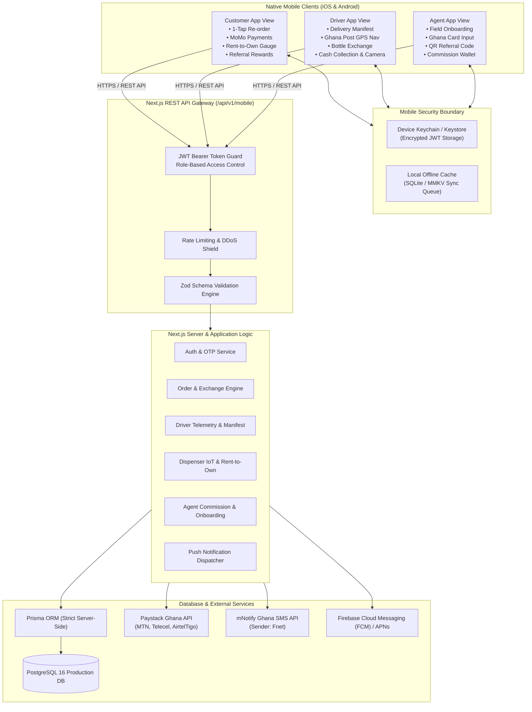
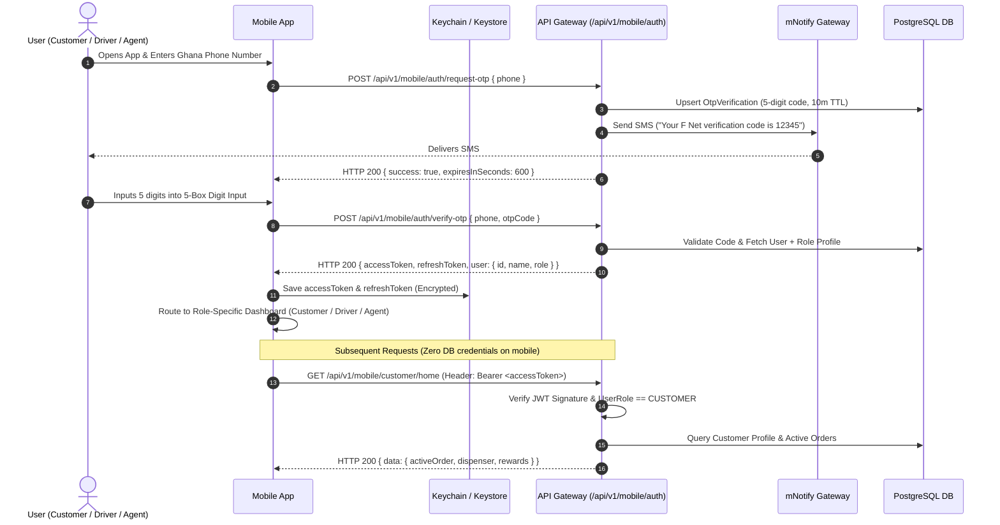
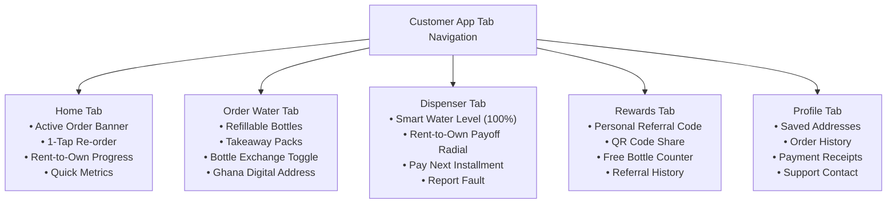
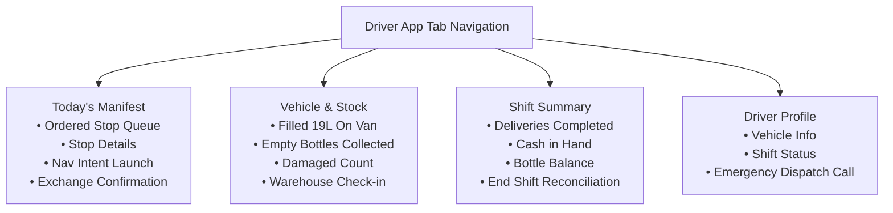
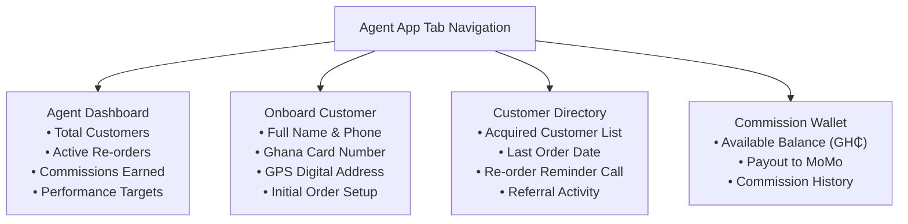
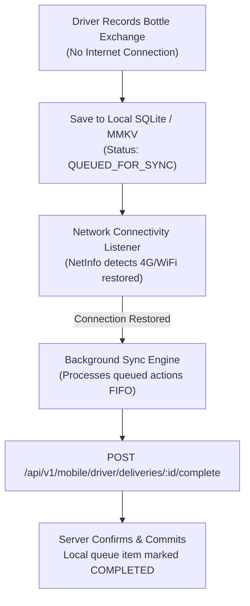
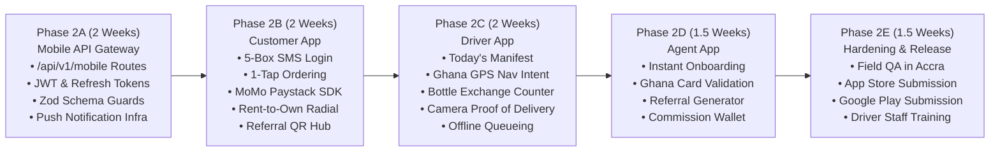

# F NET WATER HUB — MOBILE APPLICATION PRODUCT REQUIREMENTS DOCUMENT (PRD) & TECHNICAL ARCHITECTURE PLAN

**Document Version:** 2.0.0 (Phase 2 Master Blueprint)  
**System Classification:** Native / Cross-Platform Mobile Client Suite (iOS & Android)  
**Backend Infrastructure:** Next.js Server & REST API Gateway (`/api/v1/mobile/...`)  
**Primary Database:** PostgreSQL 16 (Hosted via Coolify / Docker) with Prisma ORM  
**Target Roles (Mobile App):** Customer, Driver, Agent  
**Excluded Roles (Web Only):** Administrator, Operations Manager  
**Official Brand Colors:** Primary Blue `#0057B8` | Light Blue `#00AEEF` | Dark Slate `#0F172A` | Pure White `#FFFFFF`  
**Target Market:** Ghana (Accra Metropolitan & Greater Accra Urban Hubs)  
**Local Currency:** Ghanaian Cedis (GH₵ / GHS)  

---

## 1. EXECUTIVE SUMMARY & SYSTEM SCOPE

### 1.1 Project Context & Evolution from Phase 1
F Net Water Hub has successfully deployed its Phase 1 centralized web platform, establishing core operations for water inventory, dispenser leasing, customer management, driver dispatch, and financial tracking. 

Phase 2 introduces the **F Net Water Hub Mobile Application Suite**, targeted at field agents, van drivers, and consumers across Ghana. Field operations and consumer water ordering require instant mobile access, push notifications, native GPS navigation, camera-based proof of delivery, and offline field capability.

### 1.2 Strict Scope Matrix (Mobile vs. Web)

| User Role | Web Application (Phase 1) | Mobile Application (Phase 2) | Role Scope & Rationale |
| :--- | :---: | :---: | :--- |
| **Customer** | Full Access | **Primary Target** | Instant 1-tap re-ordering, Ghana Digital Address GPS selection, Paystack Mobile Money, live driver tracking, dispenser rent-to-own payoff gauge, and referral rewards. |
| **Driver** | Responsive View | **Primary Target** | Native turn-by-turn navigation (Google Maps/Apple Maps/Waze), one-tap customer calls, bottle exchange counter, cash collection confirmation, camera delivery proof, and offline manifest caching. |
| **Agent** | Portal View | **Primary Target** | On-the-spot field customer registration with Ghana Card validation, instant referral QR generation, commission wallet tracking, and automated customer re-engagement. |
| **Manager** | **Exclusive** | **Strictly Excluded** | Large-screen dispatch orchestration, fleet assignment, inventory warehouse auditing, customer complaint resolution, and operational oversight remain on desktop/tablet web. |
| **Administrator** | **Exclusive** | **Strictly Excluded** | System configuration, user account provisioning, role adjustments, financial analytics, audit log inspections, and payment gateway configuration remain on desktop web. |

### 1.3 Core Engineering Philosophy: Decoupled Zero-Direct-DB Architecture
To guarantee absolute security, scalability, and adherence to enterprise mobile design principles:
- **No Direct Database Access:** The mobile application contains zero direct database connections, zero Prisma client code, and zero embedded database credentials.
- **RESTful API Gateway Layer:** All mobile operations communicate strictly with an authenticated, stateless REST API gateway hosted on the Next.js server under `/api/v1/mobile/...`.
- **Bearer Token & Biometric Security:** Requests are authenticated via standard JSON Web Tokens (JWT) passed in the `Authorization: Bearer <token>` HTTP header, stored in the native iOS Keychain or Android Keystore, and unlocked via Face ID or Fingerprint.
- **Payload Uniformity:** All API endpoints return a standardized JSON envelope with clear error reporting and status codes.

---

## 2. SYSTEM TOPOLOGY & ARCHITECTURE

### 2.1 Decoupled Mobile-to-Cloud Infrastructure



### 2.2 Security & Authentication Workflow



---

## 3. USER PERSONAS & ROLE EXPERIENCES

### 3.1 Persona A: The Everyday Ghanaian Water Customer
- **Demographics:** Working professionals, families, and residential tenants in Accra (East Legon, Spintex, Osu, Tema, Dansoman).
- **Core Needs:** 
  - Effortless re-orders without having to call or send multiple WhatsApp messages.
  - Transparent pricing with zero surprise charges: clear distinction between **"Returning empties (No deposit fee)"** and **"First-time order (Bottle deposit applies)"**.
  - Precise delivery tracking with Ghana Digital Address (e.g., `GA-183-9021`) and landmark notes.
  - Seamless Mobile Money checkout (MTN MoMo, Telecel Cash, AirtelTigo).
  - Clear visibility into Dispenser Rent-to-Own installment balances and water levels.
  - Rewarding referrals: 5 successful friend orders earn 1 free water bottle.

### 3.2 Persona B: The Field Van Driver
- **Demographics:** Delivery van drivers navigating heavy Accra urban traffic.
- **Core Needs:**
  - Clear, organized daily delivery stop queue sorted by proximity or assigned priority.
  - One-tap launch of native navigation apps (Google Maps, Apple Maps, Waze) directly to the customer's Ghana Digital Address coordinates.
  - Direct customer contact button for gate arrival.
  - Simple, large touch-friendly counter for bottle exchange:
    - **Bottles Delivered**
    - **Empty Bottles Collected**
    - **Damaged Bottles**
    - **Cash Collected** (for cash-on-delivery orders)
  - Quick camera capture for photo proof of delivery or damaged bottle documentation.
  - Offline capability so deliveries can be recorded in underground parking or low-reception zones.

### 3.3 Persona C: The Commissioned Field Sales Agent
- **Demographics:** Direct sales representatives and community ambassadors working residential estates and commercial plazas.
- **Core Needs:**
  - High-speed on-the-spot customer registration: capturing full name, phone number, Ghana Card number, and delivery location.
  - Instant referral QR code display: new customers can scan the agent's screen to install the app with the agent's referral code pre-filled.
  - Transparent commission wallet: tracking earned commissions per completed water delivery and dispenser lease.
  - Instant mobile money cash-out request to their registered MoMo wallet.
  - Customer directory to follow up with inactive clients and trigger re-order reminders.

---

## 4. DETAILED SCREEN SPECIFICATIONS & UI BLUEPRINTS

All mobile screens adhere strictly to the **Plain, Natural Language Standard** (no developer jargon, no em dashes, clean SVG icons, no raw HTML entities) and utilize the official **F Net Water Hub Brand Identity** (`#0057B8`, `#00AEEF`, `#0F172A`, `#FFFFFF`).

### 4.1 Common Authentication Flow (2-Step Progressive Standard)

#### Screen A1: Welcome & Phone Input
- **Header:** F Net Water Hub brand logo with subtle wave graphic.
- **Headline:** "Fresh, pure drinking water delivered to your doorstep."
- **Input:** Single dedicated phone input field with Ghana flag prefix `+233`, supporting local formats (`024XXXXXXX`, `050XXXXXXX`).
- **Primary CTA:** "Send Verification Code" (Full-width button, `#0057B8`).
- **Role Detection:** The backend automatically identifies whether the phone belongs to a Customer, Driver, or Agent, routing to the appropriate interface upon verification.

#### Screen A2: 5-Box Digit Verification Screen
- **Back Navigation:** Clean SVG back arrow with "Change phone number" subtext.
- **Headline:** "Enter Verification Code"
- **Instruction:** "Enter the 5-digit code sent to +233 24 123 4567"
- **Input Component:** **5-Box Digit Input Standard**
  - 5 discrete, high-contrast numeric boxes with auto-focus on first box.
  - Auto-advance on input; backspace jumps focus back to previous box.
  - Full clipboard paste detection: automatically distributes copied 5-digit code across all boxes.
- **Timer & Resend:** "Resend code in 0:45" turns into "Resend Code via SMS" when expired.
- **Biometric Prompt:** Upon first successful login, the app requests permission to enable Face ID / Fingerprint unlock for subsequent sessions.

---

### 4.2 Customer Mobile Application Experience



#### Screen C1: Customer Home Dashboard
- **Top Bar:** Location pill ("Delivering to: East Legon, GA-183-9021"), Notification Bell with unread badge, Profile avatar.
- **Hero Card (Active Order Tracking):** If an order is active:
  - Order Number (e.g., `#FNW-1042`)
  - Status badge: "Driver Assigned" or "Out for Delivery"
  - Interactive stepper: Order Placed $\rightarrow$ Driver Assigned $\rightarrow$ Out for Delivery $\rightarrow$ Delivered
  - Driver contact pill: Driver Name, Van Plate Number, Call Driver SVG button.
- **Quick Re-Order Widget:** "Order your regular 19L Refill with 1 tap." Pre-populated with previous address and bottle quantity.
- **Interactive RadialBar Widget:** Dispenser Rent-to-Own Progress:
  - Circular gauge showing percentage paid (e.g., `65% Paid`).
  - Next installment due date and amount: `GH₵ 150.00 due Nov 28`.
- **Referral Perk Banner:** "Refer 2 more friends to earn 1 free water bottle."

#### Screen C2: Water Ordering & Bottle Exchange
- **Product Selector:**
  - 19L Refillable Bottle (GH₵ 18.00)
  - 500ml Take-away Bottled Pack (GH₵ 25.00)
  - 750ml Premium Bottled Pack (GH₵ 30.00)
  - Bulk Supply (100+ Bottles)
- **Empty Bottle Exchange Selector (Crucial Non-Technical Copy):**
  - Radio Option 1: **"I am returning empty bottles"** (Subtext: "No bottle deposit fee charged. Swap empty for filled.")
  - Radio Option 2: **"I do not have empty bottles to return"** (Subtext: "GH₵ 35.00 refundable bottle deposit added per bottle.")
- **Address Selection:** Dropdown of saved addresses + "Add New Address with GPS".
  - Area Name (e.g., "Airport Residential")
  - Ghana Digital Address (e.g., `GA-054-2091`)
  - Delivery Instructions ("Leave with security at main gate").
- **Delivery Time Slot:** Morning (8:00 AM - 12:00 PM) | Afternoon (1:00 PM - 5:00 PM).
- **Free Bottle Redemption Toggle:** "Use 1 free bottle credit (Balance: 2 free bottles)" deducts GH₵ 18.00 from subtotal.
- **Payment Method Selection:**
  - Mobile Money (MTN MoMo, Telecel Cash, AirtelTigo)
  - Debit/Credit Card
  - Cash on Delivery

#### Screen C3: Dispenser Rent-to-Own Hub
- **Dispenser Live Status:**
  - Model Name & Serial Number (e.g., `AquaPro Hot/Cold - FNW-DSP-082`)
  - Water Level Indicator: Animated water-wave gauge (e.g., `72% remaining`).
  - Device Status: "Connected Online" (Green dot).
- **Payment Plan Breakdown:**
  - Total Cost: `GH₵ 1,800.00`
  - Total Paid: `GH₵ 1,200.00`
  - Outstanding Balance: `GH₵ 600.00`
  - Monthly Due: `GH₵ 150.00`
  - CTA Button: "Pay Next Installment via MoMo"
- **Service & Support:**
  - "Report a Dispenser Issue" (Opens simple photo upload and description form for technician dispatch).

---

### 4.3 Driver Mobile Application Experience



#### Screen D1: Today's Delivery Manifest (Route Queue)
- **Shift Status Bar:** Vehicle Plate (`GT-4281-24`), Active Shift Toggle ("On Duty" / "Break"), Inventory summary (`45 Filled | 12 Empty`).
- **Delivery Stop Cards (Sorted by optimized sequence):**
  - **Card Header:** Stop #1 • Order `#FNW-1042` • Status badge: `Assigned` or `Out for Delivery`.
  - **Customer Details:** Customer Name, Phone Number (Tap-to-Call SVG button).
  - **Delivery Location:** Area Name and Ghana Digital Address (`GA-183-9021`).
  - **Items to Deliver:** `3x 19L Refillable Bottles`.
  - **Payment Status:** `Paid via MoMo` (Green badge) OR `Collect GH₵ 54.00 Cash` (Amber badge).
  - **Action Row:**
    - Button 1: "Navigate" (Launches Google Maps or Apple Maps coordinates directly).
    - Button 2: "Start Delivery" $\rightarrow$ changes status to `Out for Delivery` and sends customer SMS notification.
    - Button 3: "Complete Delivery" (Opens exchange dialog).

#### Screen D2: Delivery Completion & Bottle Exchange Modal
- **Plain Language Standard (Strict Compliance with Project Rules):**
  - Stepper 1: **Bottles Delivered** (Counter: `[-] 3 [+]`)
  - Stepper 2: **Empty Bottles Collected** (Counter: `[-] 3 [+]`)
  - Stepper 3: **Damaged Bottles** (Counter: `[-] 0 [+]`)
- **Cash Collection Step (if Cash on Delivery):**
  - Amount due: `GH₵ 54.00`
  - Checkbox / Toggle: "Cash Collected in Full (GH₵ 54.00)"
- **Proof of Delivery:**
  - One-tap Camera button: "Take Delivery Photo (Optional/Required for unattended deliveries)".
  - Customer Signature Pad (Direct finger signature on screen).
- **Completion CTA:** Full-width "Complete Delivery" button. Updates inventory instantly and syncs to server.

#### Screen D3: Shift End Reconciliation
- **Summary Cards:**
  - Total Stops Completed: `18 of 20`
  - Total Bottles Delivered: `52 Bottles`
  - Total Empty Bottles Collected: `48 Bottles`
  - Damaged Bottles Recorded: `2 Bottles`
  - Total Cash Collected: `GH₵ 324.00`
- **Warehouse Reconciliation CTA:** "Submit Shift Handover" (Generates a QR code for warehouse manager to scan and verify stock).

---

### 4.4 Agent Mobile Application Experience



#### Screen G1: Agent Dashboard & Referral QR
- **Performance Header:** Agent Name, Agent Code (`AGT-ACC-012`), Monthly Commission Earned (`GH₵ 1,450.00`).
- **Interactive Target Gauge:** RadialBar chart showing monthly customer acquisition quota (e.g., `38 of 50 Customers Onboarded - 76%`).
- **Hero Action:** "Share Referral Code"
  - Large, high-contrast QR Code: Prospective customers scan to download the app with the agent's code pre-filled.
  - "Copy Referral Code" button (`FNET-KWAME-88`).
  - "Share via WhatsApp" deep-link button.
- **Recent Customer Activity Feed:** List of newly placed orders by registered customers, displaying immediate commission earned.

#### Screen G2: Fast Customer Onboarding Screen
- **Purpose:** Enables field agents to register residential and business customers on the spot in under 60 seconds.
- **Form Fields:**
  - Customer Full Name
  - Phone Number (validates format + checks for existing account)
  - Ghana Card Number (Format: `GHA-XXXXXXXXX-X`)
  - Delivery Address:
    - Tap "Capture Current GPS Location" button (populates lat/long coordinates automatically).
    - Ghana Digital Address (e.g., `GA-492-1082`).
    - Area / Neighborhood Name.
    - Landmark / Notes.
  - Initial Order Toggle: "Place First Order Now?" (Optional: selects 19L bottles and initiates MoMo prompt or cash on delivery).
- **CTA:** "Register Customer & Activate Account"

#### Screen G3: Commission Wallet & MoMo Cash-out
- **Wallet Balance Card:**
  - Available for Withdrawal: `GH₵ 850.00`
  - Lifetime Earnings: `GH₵ 4,200.00`
- **Withdrawal Action:**
  - Input Amount (e.g., `GH₵ 500.00`)
  - Select MoMo Network (MTN Mobile Money / Telecel Cash / AirtelTigo Money)
  - Registered MoMo Number
  - CTA: "Withdraw to Mobile Money" (Triggers backend Paystack Transfer / manual disbursement queue).
- **Transaction Ledger:** Clean list of commissions earned per customer order (+GH₵ 3.00 per refill, +GH₵ 50.00 per dispenser plan).

---

## 5. COMPLETE MOBILE REST API GATEWAY CATALOG

All endpoints are hosted on the existing Next.js web backend under `/api/v1/mobile/...`.  
Every protected endpoint requires the HTTP header:  
`Authorization: Bearer <JWT_ACCESS_TOKEN>`

### 5.1 Standard Response Envelopes

#### Success Response Envelope (HTTP 200 / 201)
```json
{
  "success": true,
  "statusCode": 200,
  "message": "Operation completed successfully.",
  "data": { ... }
}
```

#### Error Response Envelope (HTTP 400 / 401 / 403 / 404 / 422 / 500)
```json
{
  "success": false,
  "statusCode": 400,
  "error": "BAD_REQUEST",
  "message": "Invalid Ghana phone number format. Please provide a valid 10-digit number.",
  "details": [
    {
      "field": "phone",
      "issue": "Must match regex ^(\\+233|0)[235][0-9]{8}$"
    }
  ]
}
```

---

### 5.2 Authentication Endpoints

#### 5.2.1 Request SMS Verification Code
- **Route:** `POST /api/v1/mobile/auth/request-otp`
- **Auth:** Public
- **Request Body:**
  ```json
  {
    "phone": "0241234567"
  }
  ```
- **Response (200 OK):**
  ```json
  {
    "success": true,
    "statusCode": 200,
    "message": "Verification code sent successfully via SMS.",
    "data": {
      "phone": "+233241234567",
      "expiresInSeconds": 600,
      "resendAvailableInSeconds": 60
    }
  }
  ```

#### 5.2.2 Verify SMS Code & Authenticate
- **Route:** `POST /api/v1/mobile/auth/verify-otp`
- **Auth:** Public
- **Request Body:**
  ```json
  {
    "phone": "0241234567",
    "otpCode": "84920"
  }
  ```
- **Response (200 OK):**
  ```json
  {
    "success": true,
    "statusCode": 200,
    "message": "Authentication successful.",
    "data": {
      "accessToken": "eyJhbGciOiJIUzI1NiIsInR5cCI6IkpXVCJ9...",
      "refreshToken": "d8e28f3a9b4c10...",
      "expiresIn": 86400,
      "user": {
        "id": "usr-88219401",
        "name": "Kwame Mensah",
        "phone": "+233241234567",
        "email": "kwame@example.com",
        "role": "CUSTOMER",
        "avatar": null,
        "customerProfile": {
          "customerCode": "CUST-0492",
          "bottlesHeld": 3,
          "freeBottleBalance": 1,
          "referralCode": "FNET-KWAME-88"
        }
      }
    }
  }
  ```

#### 5.2.3 Refresh Session Token
- **Route:** `POST /api/v1/mobile/auth/refresh-token`
- **Auth:** Public (Requires valid Refresh Token)
- **Request Body:**
  ```json
  {
    "refreshToken": "d8e28f3a9b4c10..."
  }
  ```
- **Response (200 OK):**
  ```json
  {
    "success": true,
    "statusCode": 200,
    "data": {
      "accessToken": "eyJhbGciOiJIUzI1NiIsInR5cCI6IkpXVCJ9...",
      "refreshToken": "e9f39a4b0c5d21...",
      "expiresIn": 86400
    }
  }
  ```

---

### 5.3 Customer Endpoints

#### 5.3.1 Customer Home Dashboard Data
- **Route:** `GET /api/v1/mobile/customer/home`
- **Auth:** Bearer Token (Role: `CUSTOMER`)
- **Response (200 OK):**
  ```json
  {
    "success": true,
    "statusCode": 200,
    "data": {
      "customer": {
        "name": "Kwame Mensah",
        "customerCode": "CUST-0492",
        "bottlesHeld": 3,
        "freeBottleBalance": 1
      },
      "activeOrder": {
        "id": "ord-992140",
        "orderNumber": "FNW-2026-1042",
        "status": "OUT_FOR_DELIVERY",
        "itemCount": 2,
        "totalAmount": 36.00,
        "deliveryAddress": {
          "areaName": "East Legon",
          "digitalAddress": "GA-183-9021"
        },
        "driver": {
          "name": "Kofi Boateng",
          "phone": "+233209876543",
          "vehicleNumber": "GT-4281-24"
        }
      },
      "dispenser": {
        "model": "AquaPro Smart Dispenser",
        "status": "INSTALLED_ON_PLAN",
        "waterLevelPercent": 75,
        "percentPaid": 66.6,
        "outstandingBalance": 600.00,
        "nextPaymentDate": "2026-11-28T00:00:00.000Z",
        "monthlyDue": 150.00
      },
      "rewards": {
        "referralCode": "FNET-KWAME-88",
        "successfulReferrals": 3,
        "progressToNextFreeBottle": 3,
        "targetReferrals": 5
      }
    }
  }
  ```

#### 5.3.2 Product Catalog
- **Route:** `GET /api/v1/mobile/customer/products`
- **Auth:** Bearer Token (Role: `CUSTOMER` | `AGENT`)
- **Response (200 OK):**
  ```json
  {
    "success": true,
    "statusCode": 200,
    "data": [
      {
        "id": "prod-19l-refill",
        "name": "19L Mineral Water Refill",
        "type": "REFILLABLE_BOTTLE",
        "price": 18.00,
        "depositFee": 35.00,
        "description": "Standard 19-liter treated mineral water refill for home and office dispensers.",
        "image": "https://fnetwater.com/images/products/19l-bottle.png",
        "inStock": true
      },
      {
        "id": "prod-500ml-pack",
        "name": "500ml Bottled Pack (Pack of 16)",
        "type": "TAKEAWAY_BOTTLE",
        "price": 25.00,
        "depositFee": 0.00,
        "description": "Pack of 16 sealed 500ml bottles, perfect for personal travel and events.",
        "image": "https://fnetwater.com/images/products/500ml-pack.png",
        "inStock": true
      }
    ]
  }
  ```

#### 5.3.3 Create Water Order
- **Route:** `POST /api/v1/mobile/customer/orders`
- **Auth:** Bearer Token (Role: `CUSTOMER`)
- **Request Body:**
  ```json
  {
    "deliveryAddressId": "addr-881293",
    "deliveryDate": "2026-11-15T10:00:00.000Z",
    "deliverySlot": "Morning (8am - 12pm)",
    "deliveryInstructions": "Call when at the front security gate.",
    "items": [
      {
        "productId": "prod-19l-refill",
        "quantity": 2,
        "isReturningEmpties": true
      }
    ],
    "redeemFreeBottles": 1,
    "paymentMethod": "PAYSTACK_MOMO"
  }
  ```
- **Response (201 Created):**
  ```json
  {
    "success": true,
    "statusCode": 201,
    "message": "Order placed successfully.",
    "data": {
      "orderId": "ord-992140",
      "orderNumber": "FNW-2026-1042",
      "subtotal": 36.00,
      "depositFee": 0.00,
      "deliveryFee": 0.00,
      "discountAmount": 18.00,
      "totalAmount": 18.00,
      "paymentStatus": "UNPAID",
      "paymentMethod": "PAYSTACK_MOMO"
    }
  }
  ```

#### 5.3.4 Initialize In-App MoMo Payment
- **Route:** `POST /api/v1/mobile/customer/orders/:id/pay`
- **Auth:** Bearer Token (Role: `CUSTOMER`)
- **Request Body:**
  ```json
  {
    "channel": "momo",
    "phone": "0241234567",
    "provider": "mtn"
  }
  ```
- **Response (200 OK):**
  ```json
  {
    "success": true,
    "statusCode": 200,
    "message": "Payment prompt initiated on mobile.",
    "data": {
      "reference": "FNW-PAY-8821948",
      "authorizationUrl": "https://checkout.paystack.com/access_code_123",
      "accessCode": "09823412",
      "amount": 18.00,
      "currency": "GHS"
    }
  }
  ```

#### 5.3.5 Customer Delivery Addresses
- **Route:** `GET /api/v1/mobile/customer/addresses` & `POST /api/v1/mobile/customer/addresses`
- **Auth:** Bearer Token (Role: `CUSTOMER`)
- **POST Request Body:**
  ```json
  {
    "category": "HOME",
    "areaName": "East Legon",
    "digitalAddress": "GA-183-9021",
    "gpsLatitude": 5.6354,
    "gpsLongitude": -0.1582,
    "deliveryInstructions": "Grey two-storey house near American House",
    "isDefault": true
  }
  ```

#### 5.3.6 Dispenser Installment Payment
- **Route:** `POST /api/v1/mobile/customer/dispenser/installment-pay`
- **Auth:** Bearer Token (Role: `CUSTOMER`)
- **Request Body:**
  ```json
  {
    "amount": 150.00,
    "channel": "momo",
    "phone": "0241234567",
    "provider": "mtn"
  }
  ```

---

### 5.4 Driver Endpoints

#### 5.4.1 Driver Today's Delivery Manifest
- **Route:** `GET /api/v1/mobile/driver/manifest/today`
- **Auth:** Bearer Token (Role: `DRIVER`)
- **Response (200 OK):**
  ```json
  {
    "success": true,
    "statusCode": 200,
    "data": {
      "shiftDate": "2026-11-14",
      "vehiclePlate": "GT-4281-24",
      "totalStops": 12,
      "completedStops": 4,
      "stops": [
        {
          "deliveryId": "del-88129",
          "orderId": "ord-992140",
          "orderNumber": "FNW-2026-1042",
          "sequence": 1,
          "status": "OUT_FOR_DELIVERY",
          "customer": {
            "name": "Kwame Mensah",
            "phone": "+233241234567"
          },
          "address": {
            "areaName": "East Legon",
            "digitalAddress": "GA-183-9021",
            "gpsLatitude": 5.6354,
            "gpsLongitude": -0.1582,
            "instructions": "Call upon arrival at gate"
          },
          "items": [
            {
              "productName": "19L Mineral Water Refill",
              "quantity": 2,
              "isReturningEmpties": true
            }
          ],
          "payment": {
            "method": "PAYSTACK_MOMO",
            "status": "PAID",
            "amountToCollect": 0.00
          }
        }
      ]
    }
  }
  ```

#### 5.4.2 Mark Delivery "Out for Delivery"
- **Route:** `POST /api/v1/mobile/driver/deliveries/:id/start`
- **Auth:** Bearer Token (Role: `DRIVER`)
- **Response (200 OK):**
  ```json
  {
    "success": true,
    "statusCode": 200,
    "message": "Delivery is now out for delivery. Customer notified via SMS."
  }
  ```

#### 5.4.3 Record Bottle Exchange & Complete Delivery
- **Route:** `POST /api/v1/mobile/driver/deliveries/:id/complete`
- **Auth:** Bearer Token (Role: `DRIVER`)
- **Request Body (Adhering to Plain Language Standard):**
  ```json
  {
    "filledDelivered": 2,
    "emptyCollected": 2,
    "damagedCount": 0,
    "lostCount": 0,
    "cashCollected": 0.00,
    "proofOfDeliveryPhotoUrl": "https://storage.fnetwater.com/pod/del-88129.jpg",
    "customerNotes": "Delivered to security post as instructed."
  }
  ```
- **Response (200 OK):**
  ```json
  {
    "success": true,
    "statusCode": 200,
    "message": "Delivery completed and bottle exchange recorded."
  }
  ```

#### 5.4.4 Periodic Driver GPS Telemetry
- **Route:** `POST /api/v1/mobile/driver/telemetry`
- **Auth:** Bearer Token (Role: `DRIVER`)
- **Request Body:**
  ```json
  {
    "latitude": 5.6358,
    "longitude": -0.1579,
    "accuracyMeters": 4.5,
    "batteryLevel": 88,
    "timestamp": "2026-11-14T10:45:12.000Z"
  }
  ```

---

### 5.5 Agent Endpoints

#### 5.5.1 Agent Performance Dashboard
- **Route:** `GET /api/v1/mobile/agent/dashboard`
- **Auth:** Bearer Token (Role: `AGENT`)
- **Response (200 OK):**
  ```json
  {
    "success": true,
    "statusCode": 200,
    "data": {
      "agentCode": "AGT-ACC-012",
      "referralCode": "FNET-AGT-12",
      "metrics": {
        "totalRegisteredCustomers": 42,
        "monthlyNewCustomers": 18,
        "monthlyTarget": 25,
        "targetCompletionRate": 72.0,
        "totalOrdersGenerated": 128,
        "monthlyCommissionGHS": 1450.00,
        "walletBalanceGHS": 850.00
      }
    }
  }
  ```

#### 5.5.2 Field Onboard Customer
- **Route:** `POST /api/v1/mobile/agent/onboard-customer`
- **Auth:** Bearer Token (Role: `AGENT`)
- **Request Body:**
  ```json
  {
    "name": "Abena Osei",
    "phone": "0509876543",
    "email": "abena@example.com",
    "ghanaCardNumber": "GHA-726190281-4",
    "deliveryAddress": {
      "category": "HOME",
      "areaName": "Spintex Road",
      "digitalAddress": "GZ-192-8819",
      "gpsLatitude": 5.6201,
      "gpsLongitude": -0.1092,
      "deliveryInstructions": "Opposite Baatsona Total Filling Station"
    },
    "createInitialOrder": true,
    "initialOrderItems": [
      {
        "productId": "prod-19l-refill",
        "quantity": 2,
        "isReturningEmpties": false
      }
    ],
    "paymentMethod": "CASH_ON_DELIVERY"
  }
  ```
- **Response (201 Created):**
  ```json
  {
    "success": true,
    "statusCode": 201,
    "message": "Customer onboarded successfully and initial order scheduled.",
    "data": {
      "customerId": "usr-992140",
      "customerCode": "CUST-0588",
      "orderNumber": "FNW-2026-1099"
    }
  }
  ```

#### 5.5.3 Commission Wallet & Withdrawal Request
- **Route:** `POST /api/v1/mobile/agent/wallet/withdraw`
- **Auth:** Bearer Token (Role: `AGENT`)
- **Request Body:**
  ```json
  {
    "amount": 500.00,
    "network": "MTN",
    "mobileMoneyNumber": "0241234567"
  }
  ```

---

### 5.6 Shared Device Services

#### 5.6.1 Push Notification Device Registration
- **Route:** `POST /api/v1/mobile/device/register-push`
- **Auth:** Bearer Token (Any authenticated role)
- **Request Body:**
  ```json
  {
    "deviceToken": "fcm_token_string_88921...",
    "platform": "ANDROID",
    "appVersion": "1.0.0",
    "deviceModel": "Samsung Galaxy A54"
  }
  ```

---

## 6. NATIVE CAPABILITIES & HARDWARE INTEGRATIONS

### 6.1 Native GPS & Ghana Post Navigation
- **Driver Navigation:** Instead of building a custom in-app map renderer that drains battery and consumes heavy data, the driver app triggers native OS navigation intents:
  - Deep link: `geo:${lat},${lng}?q=${encodeURIComponent(digitalAddress)}`
  - Fallback URLs: Google Maps (`comgooglemaps://`), Apple Maps (`maps://`), and Waze (`waze://`).
- **Customer Address Capture:** Built-in Geolocation API fetches high-precision coordinates (`navigator.geolocation.getCurrentPosition`) and validates against the Ghana Post GPS format (`^[A-Z]{2}-\d{3,4}-\d{4}$`).

### 6.2 Camera & Barcode/QR Scanning
- **Driver POD (Proof of Delivery):** Integrated camera module compresses captured photos locally to $<300\text{ KB}$ before upload, saving driver data bundles.
- **Serial Scanner:** Scans barcode or QR stickers on 19L bottles and dispensers to verify serial numbers and eliminate inventory tracking errors.

### 6.3 Push Notifications (FCM / APNs)
- **Customer Triggers:**
  - Order confirmed
  - Driver assigned and on the way (with ETA)
  - Delivery completed
  - Dispenser installment payment due reminder
  - Free water bottle earned from referrals
- **Driver Triggers:**
  - New delivery assigned to manifest
  - Customer address or notes updated
  - Delivery cancelled by dispatch

### 6.4 Offline Caching & Background Sync Engine



- **Conflict Resolution:** If a delivery was already updated by dispatch on the web portal, the server accepts the driver's field counts (bottles delivered/collected) as authoritative.

---

## 7. MOBILE TECH STACK & DESIGN SYSTEM

### 7.1 Recommended Client Architecture: React Native & Expo
- **Framework:** **React Native (Expo SDK 52+)**
  - **Shared Types:** Shares TypeScript interfaces and Zod validation schemas directly with the Next.js web repository (`src/types`).
  - **Single Codebase:** Deploys natively to both iOS (App Store) and Android (Google Play Store).
  - **Over-The-Air (OTA) Updates:** Expo EAS Update enables zero-downtime instant hotfixes without waiting for App Store reviews.
- **State Management & Data Fetching:**
  - **TanStack Query (React Query v5):** Robust caching, automated background re-fetching, optimistic mutations, and offline query hydration.
  - **Zustand:** Ultra-lightweight global store for user authentication session, biometric lock state, and cart/order draft.
  - **MMKV:** 30x faster than standard AsyncStorage for local token and cache storage.
- **Styling:** **NativeWind v4 (Tailwind CSS for React Native)**
  - Exact token fidelity with web application colors (`#0057B8`, `#00AEEF`, `#0F172A`).
  - Dark mode and light mode native compliance.

### 7.2 Strict Non-Technical Copywriting Standard (Ghana Market)

| Developer / Robotic Term (STRICTLY BANNED) | Required Plain Language Term | Context |
| :--- | :--- | :--- |
| `1:1 swap` / `1:1 bottle swap` | **"Bottle exchange"** or **"Returning empties"** | Order checkout & driver modal |
| `Complete Delivery & 1:1 Swap` | **"Complete Delivery"** | Driver action button |
| `Handover` / `Point-of-Delivery Handover` | **"Delivery Details"** or **"Complete Delivery"** | Driver modal header |
| `Filled 19L Handed Over` | **"Bottles Delivered"** | Driver exchange counter |
| `Empty 19L Returned` | **"Empty Bottles Collected"** | Driver exchange counter |
| `Damaged / Broken Bottles` | **"Damaged Bottles"** | Driver exchange counter |
| `Pending Allocation` / `Dispatch Allocation`| **"Unassigned Orders"** | Driver manifest queue |
| `Remittance` | **"Cash Collected"** / **"Cash to Collect"** | Driver shift summary |
| `Dual Stock` | **"Stock Level"** or **"Van Inventory"** | Driver inventory tab |
| `&check;`, `&rarr;`, `&times;` | **Clean SVG Icons** | Buttons and badges |

---

## 8. IMPLEMENTATION ROADMAP & DELIVERY PHASES



### Phase Breakdown & Deliverables

#### Phase 2A: REST API Gateway & Authentication Engine (Weeks 1 - 2)
- Build `/src/app/api/v1/mobile/...` routes within existing Next.js project.
- Implement JWT Bearer token generation, verification middleware, and refresh token rotation.
- Integrate mNotify SMS OTP verification for mobile clients.
- Configure Firebase Cloud Messaging (FCM) push notification dispatcher.

#### Phase 2B: Customer Mobile App (Weeks 3 - 4)
- React Native project initialization with NativeWind and brand theme.
- 5-Box digit SMS authentication screen.
- Home dashboard with active order tracking and rent-to-own radial gauge.
- Water ordering flow with bottle return toggle and Ghana Digital Address selector.
- In-app Paystack Mobile Money integration.

#### Phase 2C: Driver Mobile App & Field Logistics (Weeks 5 - 6)
- Driver delivery manifest view with queue ordering.
- Native navigation intent launcher (Google Maps / Apple Maps).
- Bottle exchange dialog with plain language counters (Delivered, Collected, Damaged).
- Camera capture for photo proof of delivery.
- Offline SQLite sync queue for low-reception zones.

#### Phase 2D: Agent Mobile App & Commission Engine (Weeks 7 - 8)
- Agent performance metrics and acquisition radial gauge.
- Fast customer onboarding form with Ghana Card validation and GPS pin drop.
- Referral QR code generator and WhatsApp share deep-link.
- Commission wallet tracking and withdrawal requests.

#### Phase 2E: End-to-End Field Testing & Store Submission (Weeks 8 - 9)
- Field testing with active drivers across Accra delivery routes.
- App Store (iOS) and Google Play Store (Android) builds and metadata preparation.
- Production deployment of mobile API gateway on Coolify server.
- Driver and agent operational training.

---

## 9. NON-FUNCTIONAL REQUIREMENTS & QUALITY STANDARDS

1. **Cold Start Time:** $< 1.8\text{ seconds}$ on mid-range Android devices (e.g., Samsung Galaxy A14 / Tecno Spark).
2. **Payload Efficiency:** All API responses compressed with Gzip/Brotli, keeping mobile data usage $< 50\text{ KB}$ per typical request.
3. **Data Bundle Conservation:** Camera photos compressed locally to $< 300\text{ KB}$ before transmission.
4. **Battery Optimization:** Driver GPS telemetry throttled to 60-second intervals and paused when the vehicle is stationary.
5. **App Crash Rate:** $< 0.1\%$ crash-free sessions across production builds.
6. **Zero Direct DB Invariant:** Strictly enforced code reviews verifying that no database client packages (`@prisma/client`, `pg`, `mysql2`) are included in the mobile client bundle.

---

*This document serves as the authoritative, binding Product Requirements Document (PRD) and Technical Specification for the F Net Water Hub Mobile Application Suite.*
