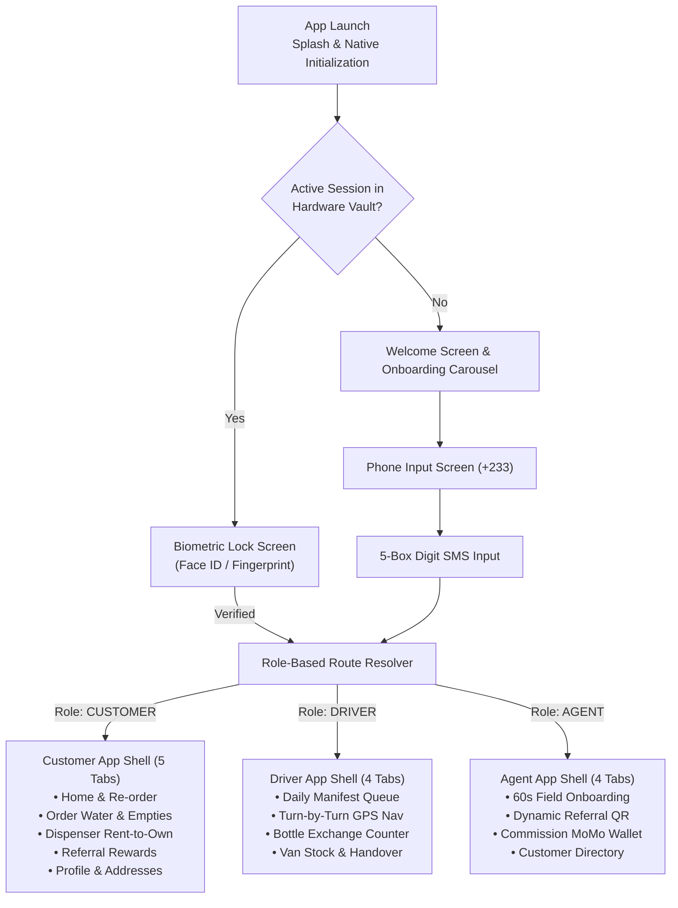

# F NET WATER HUB — MOBILE APPLICATION MASTER DEVELOPMENT PLAN

**Document Version:** 1.0.0 (Master Execution Blueprint)  
**System Classification:** Full-Stack Mobile Client Suite (iOS & Android via React Native / Expo) & Next.js REST API Gateway  
**Target Roles (Mobile App):** Customer, Driver, Field Sales Agent  
**Excluded Roles (Web Only):** Administrator, Operations Manager  
**Official Brand Tokens:** Primary Blue `#0057B8` | Light Blue `#00AEEF` | Dark Slate `#0F172A` | Pure White `#FFFFFF`  
**Target Market:** Ghana (Accra Metropolitan, Tema, and Greater Accra Urban Centers)  
**App Stores:** Apple App Store (iOS) & Google Play Store (Android)  
**Compliance Mandates:** Apple App Store Guidelines, Google Play Data Safety, FNet Engineering Rules, Anti-Slop Standard  

---

## 1. ARCHITECTURAL PRINCIPLES & DEVELOPMENT PHILOSOPHY

### 1.1 Decoupled Zero-Direct-DB Architecture
The mobile application operates as a pure stateless client communicating strictly over HTTPS with the Next.js REST API Gateway hosted under `/api/v1/mobile/...`.
- **No Direct Database Access:** Zero Prisma Client code, zero PostgreSQL credentials, and zero direct SQL queries exist in the mobile binary.
- **Single Source of Truth:** Business rules, inventory pricing, deposit calculations, and referral rewards are enforced centrally on the Next.js server.
- **Hardware-Enclave Token Security:** Authentication tokens (JWT Access + Refresh) are stored inside the native iOS Keychain or Android Keystore and unlocked via biometrics.

### 1.2 Multi-Role App Shell with Dynamic Role-Based Routing
The mobile application uses a single unified binary distributed through both app stores. Upon phone verification via mNotify SMS OTP, the backend identifies the user role (`CUSTOMER`, `DRIVER`, or `AGENT`) and loads the appropriate navigation stack.



---

## 2. MODULE-BY-MODULE DEVELOPMENT BREAKDOWN

The implementation roadmap is broken into 10 structured modules. Each module is self-contained with explicit deliverables, screen layouts, API contracts, store compliance requirements, and acceptance tests.

---

### MODULE 1: PROJECT FOUNDATIONS, TOOLING & REST API GATEWAY GROUNDWORK

#### Objective
Initialize the Expo project, configure TypeScript, establish styling tokens via NativeWind v4, and create the Next.js server-side REST API gateway foundation under `/api/v1/mobile/...`.

#### Deliverables & Technical Architecture
1. **Expo SDK 52+ Client Setup:**
   - Initialize React Native with Expo Router v4 file-based routing.
   - Configure path aliases `@/*` in `tsconfig.json`.
   - Setup `NativeWind v4` with Tailwind CSS brand tokens matching the web application (`#0057B8`, `#00AEEF`, `#0F172A`).
   - Setup `react-native-mmkv` for ultra-fast local key-value storage.
   - Setup `expo-sqlite` for driver offline manifest caching.
2. **Unified API Gateway Client (`src/services/apiClient.ts`):**
   - Axios / Fetch wrapper with automated `Authorization: Bearer <token>` injection.
   - Response interceptor for transparent 401 handling: automatically requests a new access token via `/api/v1/mobile/auth/refresh-token` and retries the original request.
   - Exponential backoff retry handler for flaky 3G/4G connections.
3. **Next.js Backend API Scaffolding:**
   - Establish `/src/app/api/v1/mobile/...` directory structure.
   - Implement JWT Bearer token generation and verification utilities using `jose`.
   - Setup Zod validation pipeline for mobile payload safety.
   - Setup CORS headers and role-based access control middleware guards.
4. **Global Application State Providers (`app/_layout.tsx`):**
   - `QueryClientProvider` (TanStack Query v5) configured with 5-minute stale times.
   - `AuthProvider` (Zustand) managing session tokens, user profile, and active role.
   - `ThemeProvider` enforcing light/dark themes with zero transition lag.
   - Toast and alert notification provider for non-blocking feedback.

---

### MODULE 2: APP DEFAULT & UNIVERSAL CORE SCREENS (FIRST-TIME UX & SYSTEM SCREENS)

#### Objective
Implement universal default screens required for initial user discovery, graceful error handling, network disconnections, and app version enforcement.

#### Screen Inventory & Specifications

```
+----------------------------------------------------------------------------------------------------+
| Screen ID: S1 | Route: /splash | Animated Native Splash Screen                                     |
| Screen ID: S2 | Route: /onboarding | 3-Step Value Proposition Carousel                             |
| Screen ID: S3 | Route: /welcome | Universal Brand Welcome Screen                                   |
| Screen ID: S4 | Route: /offline | Network Disconnected / Retry Screen                              |
| Screen ID: S5 | Route: /maintenance | System Maintenance Notice Screen                             |
| Screen ID: S6 | Route: /force-update | App Version Outdated (Store Redirect) Screen                |
| Screen ID: S7 | Route: /+not-found | 404 Route Not Found Fallback Screen                           |
+----------------------------------------------------------------------------------------------------+
```

1. **Screen S1: Animated Splash Screen (`/splash`):**
   - Official FNet Water Hub logo with subtle animated water droplet pulse.
   - Background tasks: Checks network status, queries Keychain for cached tokens, verifies app configuration.
2. **Screen S2: Onboarding Carousel (`/onboarding`):**
   - 3 interactive slides with vector artwork:
     - Slide 1: *"Pure Drinking Water Refills delivered to your door in Accra."*
     - Slide 2: *"Smart Dispensers on Rent-to-Own plans with flexible Mobile Money payments."*
     - Slide 3: *"Earn Free Water Refills by inviting your neighbors and colleagues."*
   - Skip button (top right) and "Get Started" primary CTA button.
3. **Screen S3: Welcome Screen (`/welcome`):**
   - Header with brand logo and clean tagline.
   - Primary CTA: "Get Started / Sign In with Phone".
   - Secondary Link: "Browse Water Products as Guest".
   - Footer: Links to Terms of Service and Privacy Policy.
4. **Screen S4: Offline Fallback Screen (`/offline`):**
   - Triggered automatically when device loses connectivity during a critical online action.
   - Headline: "No Internet Connection".
   - Subtext: "Please check your mobile data or Wi-Fi. We will automatically reconnect when your signal returns."
   - Action: "Try Again" button + background NetInfo listener.
5. **Screen S5: Maintenance Notice (`/maintenance`):**
   - Controlled by backend API flag `systemStatus: "MAINTENANCE"`.
   - Clean illustration, expected completion timestamp, and customer care emergency contact pill.
6. **Screen S6: Force Update Screen (`/force-update`):**
   - Enforces minimum app version checks against `/api/v1/mobile/device/app-config`.
   - Disables app usage if the installed build is below the required security minimum.
   - Primary CTA: "Update on App Store" / "Update on Google Play" (Deep-links directly to store).

---

### MODULE 3: AUTHENTICATION, SMS VERIFICATION & BIOMETRIC SECURITY

#### Objective
Implement the progressive 2-step SMS OTP authentication flow tailored for the Ghanaian telecommunications environment (MTN, Telecel, AirtelTigo).

#### Screen Inventory & Specifications

```
+----------------------------------------------------------------------------------------------------+
| Screen ID: A1 | Route: /(auth)/phone-input | Phone Number Entry (+233)                             |
| Screen ID: A2 | Route: /(auth)/verify-otp | 5-Box Digit SMS Code Verification                      |
| Screen ID: A3 | Route: /(auth)/biometric-setup | Biometric Lock Opt-In Screen                      |
| Screen ID: A4 | Route: /(auth)/biometric-unlock | Biometric Resume Screen                          |
+----------------------------------------------------------------------------------------------------+
```

1. **Screen A1: Phone Input Screen:**
   - Dedicated phone field with locked Ghana flag prefix `+233`.
   - Auto-formats input: `024 123 4567` or `241234567`.
   - Primary CTA: "Send Verification Code".
   - Submits `POST /api/v1/mobile/auth/request-otp`.
2. **Screen A2: 5-Box Digit Verification Screen:**
   - Back arrow labeled "Change phone number".
   - Headline: "Enter Verification Code".
   - Instruction: "Enter the 5-digit code sent to +233 XX XXX XXXX".
   - **5-Box Digit Input Component:**
     - 5 discrete high-contrast numeric boxes with auto-advance.
     - Full clipboard paste handling (auto-fills all 5 boxes when code is copied).
     - Backspace navigates focus to the preceding box.
   - Resend timer: 60-second countdown before enabling "Resend Code via SMS".
   - Submits `POST /api/v1/mobile/auth/verify-otp`.
3. **Screen A3 & A4: Biometric Enrollment & Lock Screen:**
   - Uses `expo-local-authentication` to check hardware capabilities (Face ID, Touch ID, Android BiometricPrompt).
   - Prompts user to enable one-tap unlock for subsequent app sessions.
   - Fallback link: "Sign In with Phone Verification Code".

---

### MODULE 4: LEGAL, COMPLIANCE & STORE REVIEW APPROVAL SCREENS

#### Objective
Fulfill mandatory Apple App Store and Google Play Store review guidelines to guarantee seamless store approval without rejections.

#### Mandatory Store Approval Requirements Matrix

| Store Review Guideline | Requirement Description | Implementation in FNet Water Hub |
| :--- | :--- | :--- |
| **Apple Guideline 5.1.1(v)** | Apps supporting account creation must offer **in-app account deletion**. | Dedicated Screen L3 allowing customers to self-delete their account and purge personal data. |
| **Apple Guideline 5.1.2** | App Tracking Transparency (ATT) framework. | Screen L4 & native iOS ATT prompt before initializing any analytics. |
| **Google Play Data Safety** | Disclose all collected data (location, phone, photos). | In-app Privacy Policy (Screen L2) explicitly disclosing location and camera usage. |
| **Background Location Disclosure** | Prominent in-app disclosure before requesting background location. | Pre-permission dialog on Driver App explaining continuous GPS tracking for route dispatch. |
| **Apple Guideline 2.1** | Demo accounts for store reviewers. | Pre-configured reviewer phone numbers with static OTPs (`84920`) documented in review notes. |

#### Screen Inventory & Specifications
1. **Screen L1: Terms of Service (`/legal/terms`):**
   - Clean, readable legal terms covering water ordering, bottle deposit rules, dispenser leasing obligations, and refund policies.
   - Includes searchable table of contents and last-updated timestamp.
2. **Screen L2: Privacy Policy (`/legal/privacy`):**
   - Comprehensive disclosure of collected data: Phone number, GPS coordinates, Ghana Digital Address, proof-of-delivery photos.
   - Clear declaration that payment credentials are processed securely by Paystack (PCI-DSS compliant) and never stored on FNet servers.
3. **Screen L3: Account Deletion & Data Safety (`/profile/delete-account`):**
   - Detailed warning outlining the consequences of account deletion (loss of reward credits, cancellation of active orders).
   - Two-step safety confirmation: User must confirm via SMS OTP before account deactivation.
   - Submits `DELETE /api/v1/mobile/customer/account`.
4. **Screen L4: Permissions Disclosures & Consent Pre-Prompts:**
   - Pre-permission modals displayed *before* triggering native OS dialogs:
     - **Location Pre-Prompt:** "We use your location to deliver water accurately to your doorstep and calculate delivery routes."
     - **Camera Pre-Prompt:** "We use your camera to capture proof of delivery and scan dispenser serial barcodes."
     - **Notification Pre-Prompt:** "Enable notifications to track your driver in real time and receive water level alerts."
5. **Screen L5: About FNet Water Hub (`/legal/about`):**
   - Application build version, build commit, customer care hotline, official company address, and open-source license acknowledgements.

---

### MODULE 5: CUSTOMER MODULE — WATER ORDERING & PAYSTACK MOMO CHECKOUT

#### Objective
Provide consumers with a fast water ordering experience, clear bottle deposit calculations, and in-app Mobile Money payments.

#### Screen Inventory & Specifications

```
+----------------------------------------------------------------------------------------------------+
| Screen ID: C1 | Route: /(customer)/index | Customer Home Dashboard & 1-Tap Re-order                |
| Screen ID: C2 | Route: /(customer)/order | Product Catalog & Empty Bottle Selector                 |
| Screen ID: C3 | Route: /(customer)/address-picker | Ghana Digital Address & Slot Selector          |
| Screen ID: C4 | Route: /(customer)/checkout | Order Review & Mobile Money Payment Modal             |
| Screen ID: C5 | Route: /(customer)/order-success | Order Placed Celebration & Receipt Screen       |
+----------------------------------------------------------------------------------------------------+
```

1. **Screen C1: Customer Home Dashboard:**
   - Active order banner (visible when delivery is in transit).
   - Quick 1-tap re-order button pre-filled with standard 2-bottle order and default address.
   - Dispenser Rent-to-Own RadialBar widget showing payoff progress.
   - Referral rewards card: "Refer 2 more friends to earn 1 free refill."
2. **Screen C2: Water Order & Bottle Return Selector:**
   - Product list: 19L Refillable Bottles (GH₵ 18.00), 500ml Bottled Packs (GH₵ 25.00), Bulk Water.
   - **Empty Bottle Return Toggle (Plain Language Standard):**
     - Option 1: *"I am returning empty bottles"* (Deposit: GH₵ 0.00).
     - Option 2: *"I do not have empty bottles to return"* (Adds GH₵ 35.00 deposit per bottle).
   - Free bottle credit toggle: Deducts GH₵ 18.00 from subtotal if credits are available.
3. **Screen C3: Delivery Address & Time Slot Selector:**
   - Address selector showing saved addresses with tags (`Home`, `Office`).
   - "Add New Address" option with GPS pin-drop and Ghana Digital Address input (`GA-183-9021`).
   - Delivery slots: Morning (8:00 AM - 12:00 PM) | Afternoon (1:00 PM - 5:00 PM).
   - Special instructions field (e.g. "Leave with front desk security").
4. **Screen C4: Checkout & Payment Modal:**
   - Summary breakdown: Refills Subtotal, Bottle Deposit Fees, Referral Discounts, Delivery Fee (Free).
   - Payment method selection:
     - Mobile Money (MTN MoMo, Telecel Cash, AirtelTigo).
     - Debit/Credit Card.
     - Cash on Delivery.
   - Integrates Paystack mobile prompt via direct API trigger.
5. **Screen C5: Order Confirmation & Receipt:**
   - Animated success checkmark with order number (`#FNW-2026-1042`).
   - Delivery window reminder.
   - Primary CTA: "Track Delivery in Real Time".

---

### MODULE 6: CUSTOMER MODULE — TRACKING, DISPENSERS & REWARDS HUB

#### Objective
Enable live driver arrival tracking, dispenser rent-to-own tracking, and referral reward management.

#### Screen Inventory & Specifications

```
+----------------------------------------------------------------------------------------------------+
| Screen ID: C6 | Route: /(customer)/track-order | Live Delivery Stepper & Driver Contact             |
| Screen ID: C7 | Route: /(customer)/dispenser | Smart Dispenser Status & Rent-to-Own Radial          |
| Screen ID: C8 | Route: /(customer)/rewards | Referral Code Hub, QR Code & Free Bottle Meter         |
| Screen ID: C9 | Route: /(customer)/order-history | Chronological Orders & Downloadable Receipts     |
| Screen ID: C10| Route: /(customer)/addresses | Saved Addresses CRUD Manager                         |
+----------------------------------------------------------------------------------------------------+
```

1. **Screen C6: Live Order Tracking:**
   - Visual 4-step progress bar: Order Placed -> Driver Assigned -> Out for Delivery -> Delivered.
   - Driver profile card: Name, vehicle plate number, and one-tap call button.
   - Real-time map displaying driver's current position and estimated delivery window.
2. **Screen C7: Dispenser Rent-to-Own Hub:**
   - Animated water level wave gauge showing remaining water percentage (e.g. `75% remaining`).
   - Financial payoff breakdown: Total plan cost (GH₵ 1,800.00), amount paid, remaining balance, monthly due date.
   - Primary CTA: "Pay Next Installment (GH₵ 150.00)" via Mobile Money.
   - Action link: "Report a Dispenser Issue" (fault ticket form with photo upload).
3. **Screen C8: Referral Rewards Hub:**
   - Unique referral code display with 1-tap clipboard copy and WhatsApp deep-link.
   - Dynamic full-screen QR code for nearby friends to scan.
   - Free bottle reward counter: Tracks progress toward next free refill (`3/5 friends referred`).
   - Referral ledger displaying names of onboarded friends and qualifying order dates.
4. **Screen C9: Order History & Receipts:**
   - Filterable list of past orders with status badges (`Delivered`, `Cancelled`).
   - Detailed order invoice view with itemized pricing and payment references.

---

### MODULE 7: DELIVERY DRIVER MODULE — MANIFEST, NAVIGATION & BOTTLE EXCHANGE

#### Objective
Equip delivery van drivers with an offline-capable daily delivery manifest, native navigation launching to Ghana Digital Addresses, and a touch-friendly bottle exchange counter.

#### Screen Inventory & Specifications

```
+----------------------------------------------------------------------------------------------------+
| Screen ID: D1 | Route: /(driver)/shift-start | Van Vehicle & Morning Stock Inspection              |
| Screen ID: D2 | Route: /(driver)/manifest | Today's Ordered Delivery Stops Manifest                |
| Screen ID: D3 | Route: /(driver)/stop-detail | Customer Stop Details & Native Nav Launch            |
| Screen ID: D4 | Route: /(driver)/exchange-modal | Bottle Exchange Counter & POD Camera Modal        |
| Screen ID: D5 | Route: /(driver)/van-stock | Real-Time Van Stock & Shift Reconciliation             |
| Screen ID: D6 | Route: /(driver)/sync-monitor | Offline Queue Sync Status Monitor                   |
+----------------------------------------------------------------------------------------------------+
```

1. **Screen D1: Shift Start & Vehicle Checklist:**
   - Assigned vehicle selection (`GT-4281-24`).
   - Morning stock verification: Driver confirms loaded filled 19L bottles.
   - Duty status toggle: Activates "On Duty" and begins periodic GPS telemetry pings.
2. **Screen D2: Today's Delivery Manifest Queue:**
   - Stop cards ordered by optimized delivery route.
   - Card details: Stop number, customer name, area, Ghana Digital Address, bottle quantity.
   - Payment status badge: `Paid via Mobile Money` (Green) or `Collect GH₵ 36.00 Cash` (Amber).
   - Offline sync indicator pill: Displays "Offline (2 queued)" when in reception dead zones.
3. **Screen D3: Stop Details & Native Navigation:**
   - Customer gate phone call button.
   - Primary CTA: "Navigate" — Launches Google Maps, Apple Maps, or Waze using deep-link intent `geo:lat,lng?q=GA-183-9021`.
   - "Start Delivery" button: Marks status `OUT_FOR_DELIVERY` and sends customer SMS update.
4. **Screen D4: Bottle Exchange & Proof of Delivery Modal:**
   - Large touch counters complying with Plain Language Standards:
     - **Bottles Delivered** (`[-] 2 [+]`)
     - **Empty Bottles Collected** (`[-] 2 [+]`)
     - **Damaged Bottles** (`[-] 0 [+]`)
   - Cash collection confirmation checkbox (for cash-on-delivery orders).
   - Camera module: Captures delivery photo, compressed to $<300\text{KB}$ locally.
   - Customer signature capture pad.
   - Primary CTA: "Complete Delivery" (Commits to server or queues in SQLite if offline).
5. **Screen D5: Van Stock & Shift Handover:**
   - Live van balance: Initial load, bottles delivered, empties collected, damaged bottles.
   - Total cash in hand summary.
   - "Submit Shift Handover" generates a summary QR code for warehouse manager check-in.

---

### MODULE 8: FIELD SALES AGENT MODULE — ONBOARDING, QR SHARING & COMMISSION WALLET

#### Objective
Enable field sales agents to onboard new customers in under 60 seconds, share dynamic referral QR codes, and withdraw earned commissions directly to Mobile Money.

#### Screen Inventory & Specifications

```
+----------------------------------------------------------------------------------------------------+
| Screen ID: G1 | Route: /(agent)/index | Agent Performance Dashboard & Monthly Target Radial        |
| Screen ID: G2 | Route: /(agent)/onboard | 60-Second Fast Customer Registration Screen              |
| Screen ID: G3 | Route: /(agent)/qr-share | Full-Screen Dynamic Referral QR Code                     |
| Screen ID: G4 | Route: /(agent)/wallet | Commission Wallet & MoMo Payout Form                      |
| Screen ID: G5 | Route: /(agent)/customers | Acquired Customer Directory & Re-order Nudge           |
+----------------------------------------------------------------------------------------------------+
```

1. **Screen G1: Agent Dashboard & Target Radial:**
   - Agent code (`AGT-ACC-012`) and available commission balance.
   - RadialBar target gauge: Monthly customer acquisition progress (e.g. `22 of 30 Customers - 73%`).
   - Recent commission feed (+GH₵ 3.00 per refill, +GH₵ 50.00 per dispenser plan).
2. **Screen G2: 60-Second Fast Customer Onboarding:**
   - Fields: Full name, Ghana phone number, Ghana Card number (`GHA-XXXXXXXXX-X`).
   - Location: "Capture Current GPS Pin" button + Ghana Digital Address input.
   - First order setup: Option to schedule initial 19L refill immediately.
   - Primary CTA: "Register Customer and Activate Account".
3. **Screen G3: Dynamic Referral QR Code:**
   - Full-screen high-contrast QR code pre-configured with agent's referral code.
   - WhatsApp share button with pre-written marketing copy.
4. **Screen G4: Commission Wallet & Payout:**
   - Balance display: Available balance vs lifetime earnings.
   - Payout form: Withdrawal amount, network selector (MTN, Telecel, AirtelTigo), MoMo number.
   - Submits `POST /api/v1/mobile/agent/wallet/withdraw` for automated Paystack transfer.
   - Itemized earnings ledger with audit trail.
5. **Screen G5: Acquired Customers Directory:**
   - Searchable directory of all onboarded clients.
   - Re-order frequency indicators and days since last order.
   - "Send Re-order Reminder" button triggering an SMS nudge.

---

### MODULE 9: BACKEND NEXT.JS REST API GATEWAY IMPLEMENTATION

#### Objective
Construct all server-side REST API routes under `/api/v1/mobile/...` within the existing Next.js web repository, connecting to PostgreSQL strictly via Prisma ORM.

#### Endpoint Implementation Matrix

```
/api/v1/mobile/
├── auth/
│   ├── request-otp.ts         # POST: Generates 5-digit OTP via mNotify
│   ├── verify-otp.ts          # POST: Validates OTP & issues JWT pair
│   ├── refresh-token.ts       # POST: Rotates access and refresh tokens
│   └── logout.ts              # POST: Invalidates active session
├── customer/
│   ├── home.ts                # GET: Fetches active orders, dispenser & rewards
│   ├── products.ts            # GET: Retrieves product catalog & pricing
│   ├── orders.ts              # POST: Creates order with bottle return logic
│   ├── orders/[id]/pay.ts     # POST: Initiates Paystack MoMo transaction
│   ├── addresses.ts           # GET/POST/PUT/DELETE: Delivery addresses CRUD
│   ├── dispenser/
│   │   ├── installment-pay.ts # POST: Charges dispenser monthly installment
│   │   └── report-fault.ts    # POST: Submits technician maintenance ticket
│   └── rewards.ts             # GET: Referral stats & free bottle balances
├── driver/
│   ├── manifest/today.ts      # GET: Returns ordered stops list for driver
│   ├── deliveries/[id]/start.ts # POST: Sets status to OUT_FOR_DELIVERY
│   ├── deliveries/[id]/complete.ts # POST: Logs bottle exchange, POD & cash
│   ├── telemetry.ts           # POST: Receives background GPS coordinates
│   └── shift/
│       ├── stock.ts           # GET: Live van inventory balance
│       └── reconcile.ts       # POST: Commits end-of-shift handover
├── agent/
│   ├── dashboard.ts           # GET: Quotas, commissions & performance
│   ├── onboard-customer.ts    # POST: Registers customer with Ghana Card & GPS
│   ├── customers.ts           # GET: List of registered customers
│   └── wallet/withdraw.ts     # POST: Dispatches Paystack MoMo payout
└── device/
    ├── register-push.ts       # POST: Saves FCM / APNs device tokens
    ├── upload-asset.ts        # POST: Multipart upload for POD photos (<300KB)
    └── app-config.ts          # GET: Returns min version & maintenance status
```

---

### MODULE 10: APP STORE & GOOGLE PLAY STORE PACKAGING, COMPLIANCE & RELEASE

#### Objective
Configure Expo Application Services (EAS), generate production binaries, fulfill all store review documentation, and deploy the apps to the Apple App Store and Google Play Store.

#### Implementation Steps
1. **App Asset Generation:**
   - App Icon: 1024x1024px PNG without transparency.
   - Android Adaptive Icons: Foreground and background layers matching brand blue `#0057B8`.
   - Splash Screen Assets: High-resolution vector graphics.
2. **EAS Build Configuration (`eas.json`):**
   - Development, preview, and production profiles.
   - Automatic version code and build number increments.
3. **Store Listing Documentation:**
   - App descriptions in plain language tailored for the Ghanaian market.
   - High-resolution localized screenshots for 6.7" iPhone, 6.5" iPhone, and Android devices.
   - Privacy Policy and Terms of Service public URLs hosted on the Next.js web server (`https://fnetwater.com/legal/privacy`).
4. **Store Reviewer Onboarding Package:**
   - Reviewer demo credentials with static OTPs.
   - Video demonstration of background GPS functionality for the driver role.

---

## 3. MASTER REVIEWER TESTING & ACCEPTANCE MATRIX

Before any module is marked complete, it must pass rigorous acceptance tests under simulated Ghanaian operating conditions (low bandwidth, 2G/3G connections, USSD delays).

| Module | Test Persona | Test Scenario | Acceptance Criteria |
| :--- | :--- | :--- | :--- |
| **Module 1** | Developer | API Gateway Connectivity | All `/api/v1/mobile/*` endpoints return standardized JSON envelopes with valid HTTP status codes and Zod validation error details. |
| **Module 2** | User | Offline Network Handling | Toggling Airplane Mode triggers Screen S4; restoring connection automatically reconnects without app crash or state loss. |
| **Module 3** | Customer | SMS OTP Login | Phone entry triggers mNotify SMS. 5-digit code auto-advances across boxes and logs into the customer portal. |
| **Module 4** | App Store Reviewer | Account Deletion (Apple 5.1.1) | User can navigate to Profile -> Delete Account, confirm with SMS OTP, and have their account permanently deactivated. |
| **Module 5** | Customer | Bottle Return Pricing | Selecting "I am returning empty bottles" results in GH₵ 0.00 deposit; toggling off adds GH₵ 35.00 deposit per bottle. |
| **Module 5** | Customer | Mobile Money Checkout | Paystack USSD prompt appears on phone; PIN confirmation updates order status to `PAID`. |
| **Module 6** | Customer | Dispenser Rent-to-Own Radial | RadialBar displays accurate percentage paid; tapping pay installment triggers MoMo payment. |
| **Module 7** | Driver | Native GPS Navigation | Tapping "Navigate" opens Google Maps or Apple Maps with the customer's Ghana Digital Address coordinates. |
| **Module 7** | Driver | Bottle Exchange Counter | Delivered, collected, and damaged bottle counters update van stock and customer bottle balances accurately. |
| **Module 7** | Driver | Offline Manifest Queue | Deliveries recorded with Airplane Mode active are saved to SQLite and automatically synced when connectivity resumes. |
| **Module 8** | Agent | 60-Second Onboarding | Agent inputs customer details, captures GPS pin, and validates Ghana Card format; account is provisioned instantly. |
| **Module 8** | Agent | MoMo Commission Withdrawal | Agent submits withdrawal request; payout triggers via Paystack Transfer and updates wallet balance immediately. |
| **Module 10** | Release Engineer | Store Binary Compilation | Clean EAS build outputs signed `.ipa` (iOS) and `.aab` (Android) binaries ready for store submission. |

---

*This document serves as the binding Master Development Plan for the F Net Water Hub Mobile Application Suite.*
