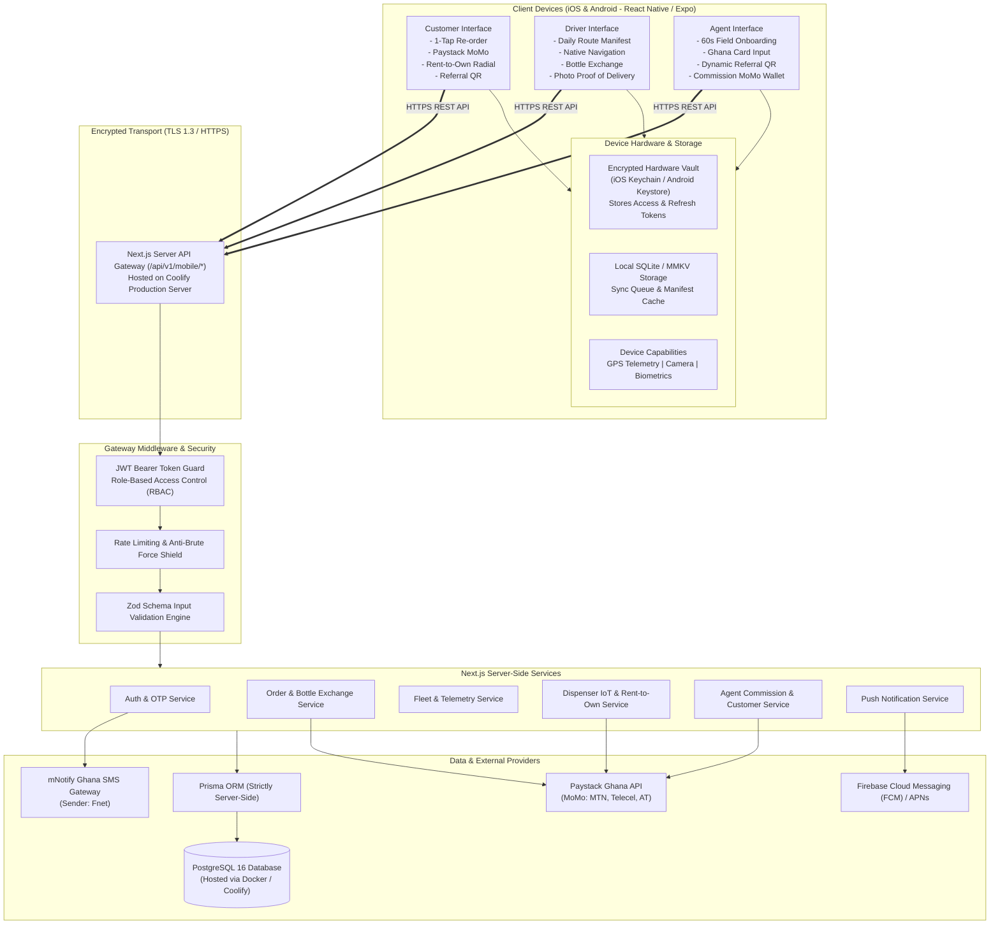
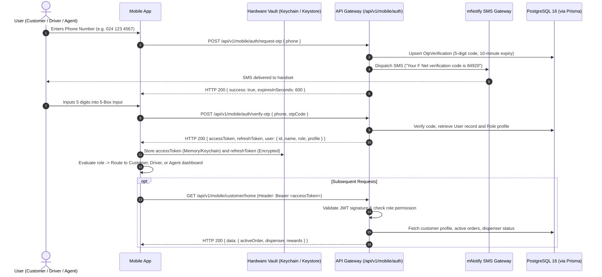
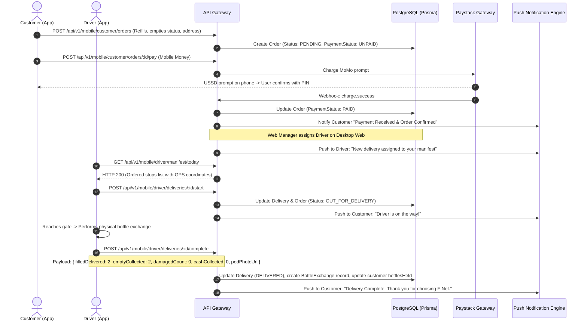
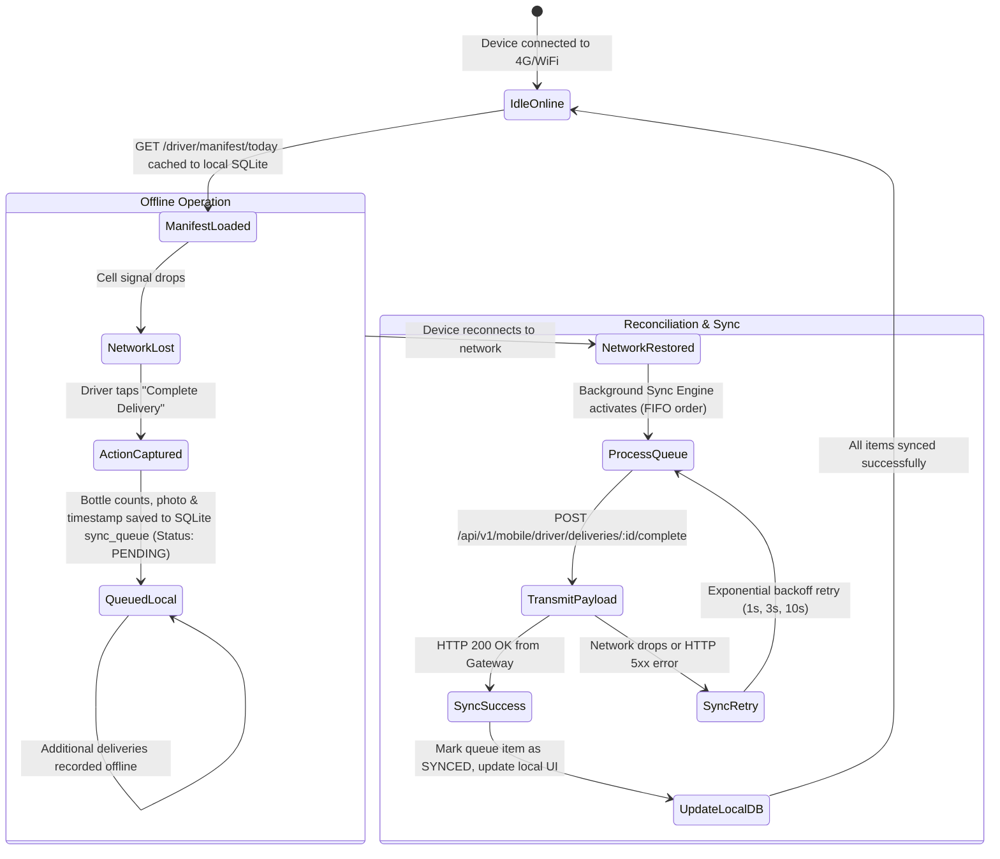
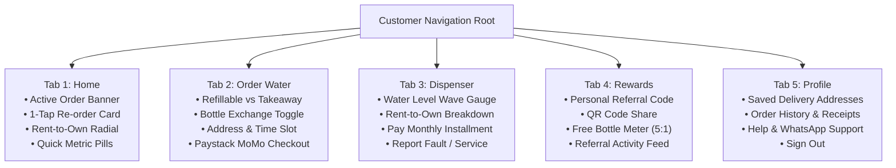
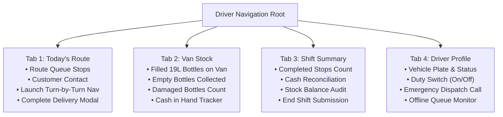
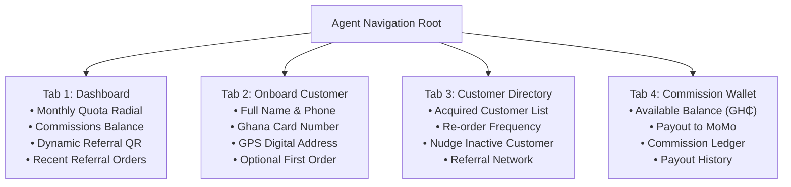
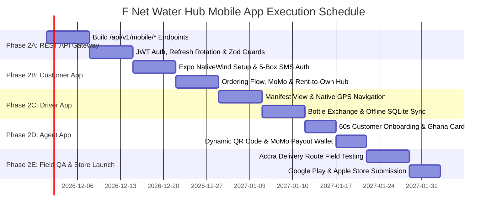

# F NET WATER HUB — MOBILE APPLICATION PRODUCT REQUIREMENTS DOCUMENT (PRD) & TECHNICAL ARCHITECTURE BLUEPRINT

**Document Version:** 2.1.0 (Master Enterprise Blueprint)  
**System Classification:** Cross-Platform Native Mobile Suite (iOS & Android via React Native / Expo)  
**Backend Infrastructure:** Next.js 15 Server & RESTful API Gateway (`/api/v1/mobile/...`)  
**Primary Database:** PostgreSQL 16 (Hosted via Coolify / Docker) managed strictly via Prisma ORM  
**Target Roles (Mobile App):** Customer, Driver, Field Sales Agent  
**Excluded Roles (Web Exclusive):** Administrator, Operations Manager  
**Official Brand Colors:** Primary Blue `#0057B8` | Light Blue `#00AEEF` | Dark Slate `#0F172A` | Pure White `#FFFFFF`  
**Target Market:** Ghana (Accra Metropolitan, Tema, and Greater Accra Urban Hubs)  
**Local Currency:** Ghanaian Cedis (GH₵ / GHS)  
**Compliance Standards:** FNet Engineering Rules, Anti-Slop Copywriting Standard, Zero-Direct-DB Security Contract  

---

## TABLE OF CONTENTS

1. [Executive Summary & Architectural Scope](#1-executive-summary--architectural-scope)  
   1.1 Business Context & Phase 2 Objectives  
   1.2 Strict Scope Matrix: Mobile App vs. Web Portal  
   1.3 Architectural Mandate: Zero-Direct-DB Decoupled Gateway  
2. [High-Level System Topology & Sequence Workflows](#2-high-level-system-topology--sequence-workflows)  
   2.1 End-to-End System Topology Diagram  
   2.2 Mobile Authentication Flow (Progressive 2-Step SMS OTP)  
   2.3 Order Lifecycle & Field Delivery Sequence  
   2.4 Offline Manifest & Sync Queue State Machine  
3. [User Personas & Role-Specific Requirements](#3-user-personas--role-specific-requirements)  
   3.1 Persona A: Residential & Commercial Customer  
   3.2 Persona B: Delivery Van Driver  
   3.3 Persona C: Commissioned Field Sales Agent  
4. [Exhaustive Screen Specifications & Layout Blueprints](#4-exhaustive-screen-specifications--layout-blueprints)  
   4.1 Common Authentication & Security Screens  
   4.2 Customer Mobile Application Experience (5 Core Tabs)  
   4.3 Driver Mobile Application Experience (4 Operational Tabs)  
   4.4 Agent Mobile Application Experience (4 Field Tabs)  
5. [Complete REST API Gateway Specification (`/api/v1/mobile/...`)](#5-complete-rest-api-gateway-specification)  
   5.1 Standard Response & Error Envelopes  
   5.2 Authentication & Session Endpoints  
   5.3 Customer Mobile Endpoints  
   5.4 Driver Mobile Endpoints  
   5.5 Agent Mobile Endpoints  
   5.6 Shared Device & System Endpoints  
6. [Security, Authentication & Data Protection](#6-security-authentication--data-protection)  
   6.1 Token Lifecycle (JWT Access + Refresh Rotation)  
   6.2 Native Keystore & Keychain Integration  
   6.3 Biometric Guard Implementation  
   6.4 API Rate Limiting, RBAC & Payload Validation  
7. [Native Hardware Integration & Field Capabilities](#7-native-hardware-integration--field-capabilities)  
   7.1 Native Turn-by-Turn Navigation & Ghana Post GPS  
   7.2 Camera & Barcode/QR Scanning Integration  
   7.3 Push Notifications (FCM / APNs)  
   7.4 Offline Database & Background Synchronization  
8. [Mobile Tech Stack & Frontend Design System](#8-mobile-tech-stack--frontend-design-system)  
   8.1 Technology Selections & Rationale  
   8.2 Directory Structure & Modular Organization  
   8.3 Design Tokens & Plain Language Copywriting Rules  
9. [Implementation Roadmap, Sprints & Verification Guide](#9-implementation-roadmap-sprints--verification-guide)  
   9.1 Multi-Phase Execution Schedule  
   9.2 Reviewer Testing Matrix & Acceptance Criteria  

---

## 1. EXECUTIVE SUMMARY & ARCHITECTURAL SCOPE

### 1.1 Business Context & Phase 2 Objectives
F Net Water Hub operates an automated water distribution, bottle exchange, and dispenser leasing network across Accra, Ghana. Following the successful deployment of the Phase 1 centralized web platform (which handles back-office logistics, master inventory, fleet dispatch, financial accounting, and administrative oversight), **Phase 2 launches the unified mobile application client**.

The mobile application is built specifically for users operating on the move in Ghana:
1. **Consumers & Businesses (Customers)** who need fast, frictionless water re-orders, real-time driver tracking, mobile money payments (MTN, Telecel, AirtelTigo), dispenser rent-to-own tracking, and referral reward redemption.
2. **Delivery Van Drivers (Drivers)** navigating dense Accra traffic who require an offline-ready daily delivery manifest, native navigation launching to Ghana Digital Addresses, simplified bottle exchange logging, camera-based proof of delivery, and cash collection tracking.
3. **Field Sales Agents (Agents)** onboarding residential tenants, offices, and shops on the ground with instant Ghana Card verification, dynamic referral QR codes, and a real-time commission payout wallet.

### 1.2 Strict Scope Matrix: Mobile App vs. Web Portal

To maintain clean operational separation, system stability, and strict device ergonomics, user roles are divided cleanly between platforms. Desktop and administrative tasks are strictly barred from the mobile application.

| Operational Domain | Role | Web Application (Phase 1) | Mobile Application (Phase 2) | Role Boundary & Rationale |
| :--- | :--- | :---: | :---: | :--- |
| **Consumer Ordering** | **Customer** | Full Portal | **Primary Experience** | Customers primarily order water on mobile devices. Features 1-tap re-ordering, Ghana Digital Address GPS selection, Paystack Mobile Money, driver tracking, and dispenser rent-to-own tracking. |
| **Field Logistics** | **Driver** | Read-Only Summary | **Primary Experience** | Drivers require native smartphone capabilities: turn-by-turn navigation (Google Maps, Apple Maps, Waze), camera capture for proof of delivery, phone call integration, and offline caching. |
| **Direct Sales** | **Agent** | Web Portal View | **Primary Experience** | Field agents onboard customers on foot. The mobile app provides rapid customer registration with Ghana Card validation, QR code referral generation, and instant MoMo commission withdrawals. |
| **Operations Oversight** | **Manager** | **Exclusive** | **Strictly Excluded** | Multi-screen dispatch orchestration, fleet assignment, bulk warehouse inventory transfers, customer dispute mediation, and route optimization belong exclusively on desktop web. |
| **System Administration** | **Admin** | **Exclusive** | **Strictly Excluded** | Financial ledger audits, payment gateway configuration, staff provisioning, system security parameters, and raw database maintenance remain strictly on desktop web. |

### 1.3 Architectural Mandate: Zero-Direct-DB Decoupled Gateway

```
+----------------------------------------------------------------------------------------------------+
|                                 STRICT ARCHITECTURAL INVARIANT                                     |
|                                                                                                    |
|  The mobile application suite MUST NOT connect directly to PostgreSQL, MUST NOT import Prisma    |
|  Client, and MUST NOT embed database credentials under any circumstance.                           |
|                                                                                                    |
|  Every mobile transaction, telemetry ping, order creation, and status query MUST communicate      |
|  exclusively over HTTPS via the authenticated Next.js REST API Gateway under `/api/v1/mobile/...`. |
+----------------------------------------------------------------------------------------------------+
```

#### Engineering Rationale
1. **Perimeter Security:** Direct database exposure from mobile clients requires exposing PostgreSQL to the public internet, opening attack vectors such as credential extraction through binary reverse-engineering.
2. **Connection Pooling Protection:** Thousands of mobile clients connecting directly to PostgreSQL would instantly saturate connection pools, causing database starvation and server crashes.
3. **Business Logic Centralization:** All business rules (bottle deposit fees, referral qualifications, commission calculations, dispenser installment schedules) are maintained in one place on the Next.js backend.
4. **Resilient Data Contracts:** Strict JSON request/response envelopes validate all payloads via Zod before touching the database.

---

## 2. HIGH-LEVEL SYSTEM TOPOLOGY & SEQUENCE WORKFLOWS

### 2.1 End-to-End System Topology Diagram

The diagram below details the boundary between the mobile client layer, the security perimeter, the Next.js API Gateway, server-side services, and backend data sources.



---

### 2.2 Mobile Authentication Flow (Progressive 2-Step SMS OTP)

Mobile authentication is passwordless by default, using Ghanaian phone numbers and 5-digit verification codes sent via SMS. This matches consumer expectations in Ghana.



---

### 2.3 Order Lifecycle & Field Delivery Sequence

This sequence illustrates how an order moves from customer placement through driver delivery, bottle exchange, and back-office sync.



---

### 2.4 Offline Manifest & Sync Queue State Machine

Drivers frequently encounter areas with weak or no cellular reception (underground parking, basements, remote roads). The driver app operates smoothly offline through an automated synchronization queue.



---

## 3. USER PERSONAS & ROLE-SPECIFIC REQUIREMENTS

### 3.1 Persona A: Residential & Commercial Customer

```
+----------------------------------------------------------------------------------------------------+
| Name: Kwame Mensah (Residential Customer) & Nana Ama (Office Manager)                             |
| Locations: East Legon, Spintex, Airport Residential, Tema Community 6                              |
| Devices: iPhone 13, Samsung Galaxy A34, Tecno Camon 20                                            |
+----------------------------------------------------------------------------------------------------+
```

#### Core Pain Points & Solutions
- **Pain Point:** Calling water depots repeatedly or waiting on WhatsApp messages for refills.  
  **Solution:** 1-tap re-order button on the home screen that pre-fills their standard order quantity and delivery address.
- **Pain Point:** Confusion over bottle fees when swapping empties versus buying new bottles.  
  **Solution:** Clear, non-technical toggle: **"I am returning empty bottles"** (no deposit fee) versus **"I do not have empty bottles to return"** (adds standard deposit fee of GH₵ 35.00 per bottle).
- **Pain Point:** Unclear delivery arrival times.  
  **Solution:** Visual delivery stepper with live driver status, vehicle plate number, and a direct tap-to-call button.
- **Pain Point:** Tracking dispenser rent-to-own installments.  
  **Solution:** Interactive circular progress gauge displaying the percentage paid, next due date, remaining balance, and a direct button to pay via Mobile Money.
- **Pain Point:** Lack of referral incentives.  
  **Solution:** A referral tracking hub where sharing a code or QR link gives 1 free water bottle refill for every 5 successful friends onboarded.

---

### 3.2 Persona B: Delivery Van Driver

```
+----------------------------------------------------------------------------------------------------+
| Name: Kofi Boateng (Van Delivery Driver)                                                           |
| Assigned Vehicle: Hyundai Mighty Van (Plate: GT-4281-24)                                           |
| Device: Samsung Galaxy A14 / Infinix Hot 30 (Android) mounted on van dashboard                      |
+----------------------------------------------------------------------------------------------------+
```

#### Core Pain Points & Solutions
- **Pain Point:** Deciphering complex addresses while driving in heavy traffic.  
  **Solution:** One-tap button that launches native navigation (Google Maps, Apple Maps, or Waze) directly to the customer's Ghana Digital Address coordinates.
- **Pain Point:** Gate access delays at residential communities.  
  **Solution:** Direct phone icon on every delivery card that triggers an instant phone call to the customer.
- **Pain Point:** Recording bottle swaps accurately under time pressure.  
  **Solution:** Large, glove-friendly touch counters for:
  - Bottles Delivered
  - Empty Bottles Collected
  - Damaged Bottles
  - Cash Collected (for cash-on-delivery orders)
- **Pain Point:** Network dropouts causing lost delivery records.  
  **Solution:** Automatic offline caching in SQLite. Deliveries recorded offline are queued locally and synchronized in the background once cellular connectivity returns.
- **Pain Point:** Unclear stock tracking during shifts.  
  **Solution:** A live van stock tab displaying remaining filled bottles, collected empties, and collected cash, simplifying end-of-shift warehouse handover.

---

### 3.3 Persona C: Commissioned Field Sales Agent

```
+----------------------------------------------------------------------------------------------------+
| Name: Abena Osei (Field Sales Executive)                                                           |
| Operating Areas: Commercial plazas, gated residential estates, business districts                  |
| Device: iPhone 11 / Tecno Spark 10                                                                 |
+----------------------------------------------------------------------------------------------------+
```

#### Core Pain Points & Solutions
- **Pain Point:** High friction when signing up customers manually with paper forms.  
  **Solution:** A 60-second onboarding form capturing name, phone number, Ghana Card number, and GPS address pin in a clean single flow.
- **Pain Point:** Slow customer registration at promotional events.  
  **Solution:** A full-screen dynamic QR code on the agent's phone. Prospective customers scan it to download the app with the agent's referral code automatically applied.
- **Pain Point:** Lack of visibility into commission earnings.  
  **Solution:** Real-time commission wallet updating instantly when referred customers receive completed deliveries (+GH₵ 3.00 per refill, +GH₵ 50.00 per dispenser plan).
- **Pain Point:** Delayed payout processing.  
  **Solution:** One-tap withdrawal request transferring funds directly to their registered MTN, Telecel, or AirtelTigo Mobile Money wallet.

---

## 4. EXHAUSTIVE SCREEN SPECIFICATIONS & LAYOUT BLUEPRINTS

Every screen adheres strictly to the **Anti-Slop Copywriting Standard** (no marketing buzzwords, no em dashes, clean SVG icons) and applies the official **F Net Water Hub Design Tokens** (`#0057B8`, `#00AEEF`, `#0F172A`, `#FFFFFF`).

### 4.1 Common Authentication & Security Screens

#### Screen A1: Welcome & Phone Input
- **Header:** Centered F Net Water Hub official logo (`/images/logo/logo.svg`).
- **Headline:** "Pure drinking water delivered to your doorstep."
- **Phone Input Component:** Dedicated numeric input with fixed Ghana flag icon and `+233` country code prefix. Supports formats like `024 123 4567` or `241234567`.
- **Primary CTA:** "Send Verification Code" (Full width, `#0057B8`, height 48px, rounded 12px).
- **Terms Notice:** "By continuing, you agree to our Terms of Service and Privacy Policy."
- **Backend Flow:** Submits `POST /api/v1/mobile/auth/request-otp`. Automatically identifies role (Customer, Driver, Agent) upon verification.

#### Screen A2: 5-Box Digit Verification Screen
- **Back Navigation:** Clean SVG arrow with label "Change phone number".
- **Headline:** "Enter Verification Code"
- **Subtext:** "Enter the 5-digit code sent to +233 24 123 4567"
- **5-Box Digit Input Component:**
  - 5 high-contrast square input boxes (48x56px, rounded 8px, border `#E2E8F0`, active border `#0057B8`).
  - Auto-advances focus to next box upon entering a digit.
  - Backspace shifts focus to previous box.
  - Full clipboard paste handling (pasting `84920` populates all 5 boxes).
- **Cooldown & Resend:** Countdown timer ("Resend code in 0:45"). Once zero, changes to an interactive text button: "Resend Code via SMS".
- **Primary Action:** Auto-submits upon 5th digit entry, or user can tap "Verify and Continue".

#### Screen A3: Biometric Lock & Unlock Screen
- **Trigger:** Displays on app launch when an active session token exists in the hardware vault.
- **Content:** App logo, greeting ("Welcome back, Kwame"), and biometric prompt icon.
- **Action:** Triggers Face ID, Touch ID, or Android BiometricPrompt.
- **Fallback:** "Use Verification Code instead" triggers SMS OTP flow.

---

### 4.2 Customer Mobile Application Experience (5 Core Tabs)



#### Screen C1: Customer Home Dashboard
- **Top Bar:** 
  - Left: Location selector pill ("East Legon, GA-183-9021" with chevron).
  - Right: Notification bell with unread indicator dot, user profile avatar.
- **Hero Widget (Active Order Tracker):** Visible only when an order is in progress:
  - Header: Order `#FNW-2026-1042` with status pill (`Driver Assigned` / `Out for Delivery`).
  - Progress Stepper: 4 milestones (Order Placed -> Driver Assigned -> Out for Delivery -> Delivered).
  - Driver Information Card: Driver name ("Kofi Boateng"), vehicle plate number ("GT-4281-24"), and tap-to-call button.
- **Quick Re-Order Widget:** "Order regular 19L Refill with 1 tap." Pre-fills previous address and 2-bottle quantity. One tap navigates directly to final confirmation.
- **Interactive RadialBar Widget (Dispenser Rent-to-Own):**
  - Circular progress gauge showing percentage paid toward ownership (e.g., `67% Paid`).
  - Subtext: "GH₵ 150.00 due on Nov 28. GH₵ 600.00 remaining to own."
  - Action link: "View Details".
- **Referral Rewards Meter:** "Refer 2 more friends to receive 1 free water refill." Progress bar showing `3/5`.

#### Screen C2: Order Water & Bottle Return Selector
- **Product Category Tabs:**
  - 19L Refillable Bottles (Primary product)
  - Bottled Packs (500ml / 750ml takeaway packs)
  - Bulk Water Supplies
- **Item Configuration Card (19L Refillable Bottle):**
  - Price: `GH₵ 18.00 per bottle`.
  - Quantity Stepper: `[-]  2  [+]`.
- **Empty Bottle Return Selector (Plain Language Standard):**
  - Radio Card 1: **"I am returning empty bottles"** (Selected by default).
    - Subtext: "No bottle deposit fee charged. Swap empty bottles for filled ones."
    - Deposit fee: `GH₵ 0.00`.
  - Radio Card 2: **"I do not have empty bottles to return"**.
    - Subtext: "A refundable bottle deposit fee of GH₵ 35.00 applies per bottle."
    - Deposit fee calculation: `2 x GH₵ 35.00 = GH₵ 70.00`.
- **Free Bottle Reward Redemption:**
  - Toggle: "Use 1 free bottle credit (Available balance: 2)". Deducts GH₵ 18.00 from subtotal.
- **Delivery Address Picker:** Shows default address with option to select another saved address or add a new one.
- **Delivery Time Slot Selector:**
  - Morning (8:00 AM to 12:00 PM)
  - Afternoon (1:00 PM to 5:00 PM)
- **Order Summary Card:**
  - Water Refills (2x): `GH₵ 36.00`
  - Bottle Deposit Fees: `GH₵ 0.00`
  - Free Bottle Credit: `-GH₵ 18.00`
  - Delivery Fee: `FREE`
  - Total Payable: `GH₵ 18.00`
- **Payment Method Options:**
  - Mobile Money (MTN MoMo, Telecel Cash, AirtelTigo Money)
  - Debit / Credit Card (Visa, Mastercard)
  - Cash on Delivery
- **Bottom CTA:** "Proceed to Payment" (Triggers Paystack Mobile Money prompt).

#### Screen C3: Dispenser Rent-to-Own Hub
- **Device Status Card:**
  - Dispenser Model: "AquaPro Hot and Cold Dispenser (Serial: FNW-DSP-082)".
  - Connection Indicator: "Connected Online" (Green dot).
  - Water Level Indicator: Animated wave showing remaining water (e.g. `75% remaining`).
- **Rent-to-Own Financial Progress:**
  - Total Plan Cost: `GH₵ 1,800.00`
  - Total Amount Paid: `GH₵ 1,200.00`
  - Outstanding Balance: `GH₵ 600.00`
  - Monthly Installment: `GH₵ 150.00`
  - Next Payment Due Date: `November 28, 2026`
- **Payment CTA:** "Pay Next Installment (GH₵ 150.00)" via Mobile Money.
- **Support Action:** "Report a Dispenser Issue" (Opens a quick fault report form with photo upload).

#### Screen C4: Referral Rewards Hub
- **Hero Card:** "Earn Free Water by Inviting Friends."
- **Referral Code Card:**
  - Clean code display: `FNET-KWAME-88`.
  - "Copy Code" button.
  - "Share via WhatsApp" button with pre-written message and download link.
- **QR Code View:** Large QR code for quick scanning by nearby friends.
- **Reward Progress Meter:**
  - Shows progress toward the next free bottle (e.g. `3 of 5 friends onboarded`).
  - Rule text: "Every 5 friends who complete their first refill order earn you 1 free water refill."
- **Referral Activity List:** Shows friends onboarded, qualifying order dates, and reward credit status.

#### Screen C5: Customer Profile & Addresses
- **Profile Header:** Name, phone number, customer code (`CUST-0492`), membership date.
- **Saved Delivery Addresses:**
  - List of saved addresses with tags (`Home`, `Office`).
  - Details: Ghana Digital Address (e.g. `GA-183-9021`), area name, delivery instructions.
  - "Add New Address with GPS" button.
- **Order History:** Chronological list of past orders with dates, items, amounts, and receipt download links.
- **Customer Support:** Direct WhatsApp chat button and customer care phone line.

---

### 4.3 Driver Mobile Application Experience (4 Operational Tabs)



#### Screen D1: Today's Delivery Manifest (Route Queue)
- **Top Shift Bar:**
  - Vehicle Plate: `GT-4281-24`.
  - Shift Status: "On Duty" toggle.
  - Van Inventory Pill: `38 Filled | 14 Empties`.
  - Offline Sync Indicator: Displays "Offline (2 queued)" when without reception.
- **Delivery Stop Cards (Ordered by route sequence):**
  - **Header:** Stop #1 of 14 • Order `#FNW-2026-1042` • Status: `Assigned` or `Out for Delivery`.
  - **Customer Details:** Customer Name ("Kwame Mensah"), Delivery Area ("East Legon"), Ghana Digital Address ("GA-183-9021").
  - **Contact Button:** Phone icon launches an immediate call to the customer.
  - **Delivery Items:** `2x 19L Refillable Bottles`.
  - **Payment Status Pill:**
    - `Paid via Mobile Money` (Green) OR
    - `Collect GH₵ 36.00 Cash` (Amber alert).
  - **Action Row:**
    - Button 1: **"Navigate"** (Launches Google Maps or Apple Maps with GPS coordinates).
    - Button 2: **"Start Delivery"** (Changes status to `Out for Delivery` and sends customer notification).
    - Button 3: **"Complete Delivery"** (Opens bottle exchange and proof of delivery modal).

#### Screen D2: Bottle Exchange & Delivery Completion Modal
- **Plain Language Standard Compliance:**
  - Counter 1: **Bottles Delivered** (Numeric stepper: `[-] 2 [+]`).
  - Counter 2: **Empty Bottles Collected** (Numeric stepper: `[-] 2 [+]`).
  - Counter 3: **Damaged Bottles** (Numeric stepper: `[-] 0 [+]`).
- **Cash Collection Step (if Cash on Delivery):**
  - Display: "Amount to collect: GH₵ 36.00".
  - Confirmation Checkbox: "Cash collected in full (GH₵ 36.00)".
- **Proof of Delivery:**
  - Camera Button: "Take Delivery Photo" (Compresses photo to $<300\text{KB}$ locally).
  - Customer Signature Pad: Direct on-screen signature.
- **Driver Notes:** Text field for delivery notes (e.g., "Left at reception with security guard").
- **Bottom CTA:** Full width **"Complete Delivery"** button. Commits to server or enqueues locally if offline.

#### Screen D3: Van Stock & Shift Reconciliation
- **Real-Time Van Inventory:**
  - Initial Morning Stock: `50 Filled Bottles`.
  - Bottles Delivered Today: `32 Bottles`.
  - Remaining Filled Bottles: `18 Bottles`.
  - Empty Bottles Collected: `30 Bottles`.
  - Damaged Bottles: `2 Bottles`.
- **Cash in Hand Ledger:**
  - Total Cash Collected: `GH₵ 216.00`.
  - Completed Cash Deliveries: 6 orders.
- **End-of-Shift Submission:**
  - "Submit Shift Handover" generates a verification summary and QR code for the warehouse manager to scan and verify stock upon van return.

---

### 4.4 Agent Mobile Application Experience (4 Field Tabs)



#### Screen G1: Agent Dashboard & Referral Hub
- **Agent Identity Card:** Agent Name ("Abena Osei"), Agent Code (`AGT-ACC-012`), Commission Balance (`GH₵ 850.00`).
- **Quota Progress RadialBar:**
  - Circular target gauge showing monthly customer acquisition quota (e.g., `22 of 30 Customers - 73%`).
- **Referral QR Hero:**
  - High-contrast dynamic QR code containing the agent's pre-filled registration link.
  - Prospective customers scan with their phone camera to open the app store or web registration.
  - "Share on WhatsApp" deep-link button.
- **Recent Commission Earnings Feed:** List of recent commissions (+GH₵ 3.00 for refill order by Kwame Mensah, +GH₵ 50.00 for dispenser lease by Alpha Tech Ltd).

#### Screen G2: Fast Customer Onboarding (<60 Seconds)
- **Purpose:** Designed for field sales agents registering customers door-to-door in residential estates and commercial centers.
- **Form Fields:**
  - Customer Full Name
  - Phone Number (Validates Ghanaian format and checks for existing registration)
  - Ghana Card Number (Format: `GHA-XXXXXXXXX-X`)
  - Delivery Location:
    - Button: "Capture Current GPS Pin" (Retrieves device latitude/longitude automatically).
    - Ghana Digital Address input (e.g. `GA-492-1082`).
    - Area / Neighborhood Name (e.g. "Spintex Road").
    - Landmark Notes (e.g. "Opposite Baatsona Total Station").
  - Optional First Order Setup:
    - Checkbox: "Schedule First Refill Now?"
    - Product selection (2x 19L Refillable Bottles).
    - Payment Method: Mobile Money or Cash on Delivery.
- **Primary CTA:** "Register Customer and Activate Account".

#### Screen G3: Commission Wallet & Mobile Money Cash-Out
- **Balance Overview:**
  - Available for Withdrawal: `GH₵ 850.00`
  - Total Lifetime Commissions: `GH₵ 4,200.00`
- **Withdrawal Action Form:**
  - Amount input (e.g. `GH₵ 500.00`). Minimum withdrawal: `GH₵ 50.00`.
  - Mobile Money Network selector: MTN Mobile Money, Telecel Cash, AirtelTigo Money.
  - Mobile Money Number (Pre-filled with agent's registered number or editable).
  - Primary CTA: "Withdraw to Mobile Money" (Dispatches payout via Paystack Transfers).
- **Earnings Ledger:** Itemized list of every commission credit and withdrawal debit with dates and status pills.

---

## 5. COMPLETE REST API GATEWAY SPECIFICATION

All mobile endpoints are hosted under `/api/v1/mobile/...` on the Next.js production server.  
Every protected route requires the standard HTTP header:  
`Authorization: Bearer <JWT_ACCESS_TOKEN>`

### 5.1 Standard Response & Error Envelopes

#### Success Envelope (HTTP 200 / 201)
```json
{
  "success": true,
  "statusCode": 200,
  "message": "Operation completed successfully.",
  "data": { ... }
}
```

#### Error Envelope (HTTP 400 / 401 / 403 / 404 / 422 / 500)
```json
{
  "success": false,
  "statusCode": 400,
  "error": "BAD_REQUEST",
  "message": "Invalid Ghana phone number format. Please provide a valid 10-digit number.",
  "details": [
    {
      "field": "phone",
      "issue": "Must match regex ^(\\+233|0)[235][0-9]{8}$"
    }
  ]
}
```

---

### 5.2 Authentication & Session Endpoints

#### 5.2.1 Request SMS Verification Code
- **Route:** `POST /api/v1/mobile/auth/request-otp`
- **Access:** Public
- **Request Body:**
  ```json
  {
    "phone": "0241234567"
  }
  ```
- **Response (200 OK):**
  ```json
  {
    "success": true,
    "statusCode": 200,
    "message": "Verification code sent successfully via SMS.",
    "data": {
      "phone": "+233241234567",
      "expiresInSeconds": 600,
      "resendAvailableInSeconds": 60
    }
  }
  ```

#### 5.2.2 Verify SMS Code & Authenticate
- **Route:** `POST /api/v1/mobile/auth/verify-otp`
- **Access:** Public
- **Request Body:**
  ```json
  {
    "phone": "0241234567",
    "otpCode": "84920"
  }
  ```
- **Response (200 OK):**
  ```json
  {
    "success": true,
    "statusCode": 200,
    "message": "Authentication successful.",
    "data": {
      "accessToken": "eyJhbGciOiJIUzI1NiIsInR5cCI6IkpXVCJ9...",
      "refreshToken": "d8e28f3a9b4c10...",
      "expiresIn": 86400,
      "user": {
        "id": "usr-88219401",
        "name": "Kwame Mensah",
        "phone": "+233241234567",
        "email": "kwame@example.com",
        "role": "CUSTOMER",
        "customerProfile": {
          "customerCode": "CUST-0492",
          "bottlesHeld": 3,
          "freeBottleBalance": 1,
          "referralCode": "FNET-KWAME-88"
        }
      }
    }
  }
  ```

#### 5.2.3 Refresh Access Token
- **Route:** `POST /api/v1/mobile/auth/refresh-token`
- **Access:** Public (Requires valid Refresh Token)
- **Request Body:**
  ```json
  {
    "refreshToken": "d8e28f3a9b4c10..."
  }
  ```
- **Response (200 OK):**
  ```json
  {
    "success": true,
    "statusCode": 200,
    "data": {
      "accessToken": "eyJhbGciOiJIUzI1NiIsInR5cCI6IkpXVCJ9...",
      "refreshToken": "e9f39a4b0c5d21...",
      "expiresIn": 86400
    }
  }
  ```

#### 5.2.4 Invalidate Session (Logout)
- **Route:** `POST /api/v1/mobile/auth/logout`
- **Access:** Authenticated (Bearer Token)
- **Request Body:**
  ```json
  {
    "refreshToken": "d8e28f3a9b4c10..."
  }
  ```
- **Response (200 OK):**
  ```json
  {
    "success": true,
    "statusCode": 200,
    "message": "Session invalidated successfully."
  }
  ```

---

### 5.3 Customer Mobile Endpoints

#### 5.3.1 Customer Home Dashboard Data
- **Route:** `GET /api/v1/mobile/customer/home`
- **Access:** Bearer Token (Role: `CUSTOMER`)
- **Response (200 OK):**
  ```json
  {
    "success": true,
    "statusCode": 200,
    "data": {
      "customer": {
        "name": "Kwame Mensah",
        "customerCode": "CUST-0492",
        "bottlesHeld": 3,
        "freeBottleBalance": 1
      },
      "activeOrder": {
        "id": "ord-992140",
        "orderNumber": "FNW-2026-1042",
        "status": "OUT_FOR_DELIVERY",
        "totalAmount": 36.00,
        "deliveryAddress": {
          "areaName": "East Legon",
          "digitalAddress": "GA-183-9021"
        },
        "driver": {
          "name": "Kofi Boateng",
          "phone": "+233209876543",
          "vehicleNumber": "GT-4281-24"
        }
      },
      "dispenser": {
        "model": "AquaPro Smart Dispenser",
        "status": "INSTALLED_ON_PLAN",
        "waterLevelPercent": 75,
        "percentPaid": 66.6,
        "outstandingBalance": 600.00,
        "nextPaymentDate": "2026-11-28T00:00:00.000Z",
        "monthlyDue": 150.00
      },
      "rewards": {
        "referralCode": "FNET-KWAME-88",
        "successfulReferrals": 3,
        "targetReferrals": 5
      }
    }
  }
  ```

#### 5.3.2 Product Catalog
- **Route:** `GET /api/v1/mobile/customer/products`
- **Access:** Bearer Token (Role: `CUSTOMER` | `AGENT`)
- **Response (200 OK):**
  ```json
  {
    "success": true,
    "statusCode": 200,
    "data": [
      {
        "id": "prod-19l-refill",
        "name": "19L Mineral Water Refill",
        "type": "REFILLABLE_BOTTLE",
        "price": 18.00,
        "depositFee": 35.00,
        "description": "Standard 19-liter treated mineral water refill for home and office dispensers.",
        "image": "https://fnetwater.com/images/product/19l-bottle.png",
        "inStock": true
      },
      {
        "id": "prod-500ml-pack",
        "name": "500ml Bottled Pack (Pack of 16)",
        "type": "TAKEAWAY_BOTTLE",
        "price": 25.00,
        "depositFee": 0.00,
        "description": "Pack of 16 sealed 500ml bottles.",
        "image": "https://fnetwater.com/images/product/500ml-pack.png",
        "inStock": true
      }
    ]
  }
  ```

#### 5.3.3 Create Water Order
- **Route:** `POST /api/v1/mobile/customer/orders`
- **Access:** Bearer Token (Role: `CUSTOMER`)
- **Request Body:**
  ```json
  {
    "deliveryAddressId": "addr-881293",
    "deliveryDate": "2026-11-15T10:00:00.000Z",
    "deliverySlot": "Morning (8am - 12pm)",
    "deliveryInstructions": "Call when at the front security gate.",
    "items": [
      {
        "productId": "prod-19l-refill",
        "quantity": 2,
        "isReturningEmpties": true
      }
    ],
    "redeemFreeBottles": 1,
    "paymentMethod": "PAYSTACK_MOMO"
  }
  ```
- **Response (201 Created):**
  ```json
  {
    "success": true,
    "statusCode": 201,
    "message": "Order placed successfully.",
    "data": {
      "orderId": "ord-992140",
      "orderNumber": "FNW-2026-1042",
      "subtotal": 36.00,
      "depositFee": 0.00,
      "deliveryFee": 0.00,
      "discountAmount": 18.00,
      "totalAmount": 18.00,
      "paymentStatus": "UNPAID",
      "paymentMethod": "PAYSTACK_MOMO"
    }
  }
  ```

#### 5.3.4 Initialize Mobile Money Payment
- **Route:** `POST /api/v1/mobile/customer/orders/:id/pay`
- **Access:** Bearer Token (Role: `CUSTOMER`)
- **Request Body:**
  ```json
  {
    "channel": "momo",
    "phone": "0241234567",
    "provider": "mtn"
  }
  ```
- **Response (200 OK):**
  ```json
  {
    "success": true,
    "statusCode": 200,
    "message": "Payment prompt initiated on mobile.",
    "data": {
      "reference": "FNW-PAY-8821948",
      "authorizationUrl": "https://checkout.paystack.com/access_code_123",
      "accessCode": "09823412",
      "amount": 18.00,
      "currency": "GHS"
    }
  }
  ```

#### 5.3.5 Delivery Addresses Management
- **Routes:** 
  - `GET /api/v1/mobile/customer/addresses`
  - `POST /api/v1/mobile/customer/addresses`
  - `PUT /api/v1/mobile/customer/addresses/:id`
  - `DELETE /api/v1/mobile/customer/addresses/:id`
- **POST Request Body:**
  ```json
  {
    "category": "HOME",
    "areaName": "East Legon",
    "digitalAddress": "GA-183-9021",
    "gpsLatitude": 5.6354,
    "gpsLongitude": -0.1582,
    "deliveryInstructions": "Grey house opposite American House",
    "isDefault": true
  }
  ```

#### 5.3.6 Dispenser Installment Payment
- **Route:** `POST /api/v1/mobile/customer/dispenser/installment-pay`
- **Access:** Bearer Token (Role: `CUSTOMER`)
- **Request Body:**
  ```json
  {
    "amount": 150.00,
    "channel": "momo",
    "phone": "0241234567",
    "provider": "mtn"
  }
  ```

---

### 5.4 Driver Mobile Endpoints

#### 5.4.1 Today's Delivery Manifest
- **Route:** `GET /api/v1/mobile/driver/manifest/today`
- **Access:** Bearer Token (Role: `DRIVER`)
- **Response (200 OK):**
  ```json
  {
    "success": true,
    "statusCode": 200,
    "data": {
      "shiftDate": "2026-11-15",
      "vehiclePlate": "GT-4281-24",
      "totalStops": 12,
      "completedStops": 4,
      "stops": [
        {
          "deliveryId": "del-88129",
          "orderId": "ord-992140",
          "orderNumber": "FNW-2026-1042",
          "sequence": 1,
          "status": "OUT_FOR_DELIVERY",
          "customer": {
            "name": "Kwame Mensah",
            "phone": "+233241234567"
          },
          "address": {
            "areaName": "East Legon",
            "digitalAddress": "GA-183-9021",
            "gpsLatitude": 5.6354,
            "gpsLongitude": -0.1582,
            "instructions": "Call at security gate"
          },
          "items": [
            {
              "productName": "19L Mineral Water Refill",
              "quantity": 2,
              "isReturningEmpties": true
            }
          ],
          "payment": {
            "method": "PAYSTACK_MOMO",
            "status": "PAID",
            "amountToCollect": 0.00
          }
        }
      ]
    }
  }
  ```

#### 5.4.2 Start Delivery Run
- **Route:** `POST /api/v1/mobile/driver/deliveries/:id/start`
- **Access:** Bearer Token (Role: `DRIVER`)
- **Response (200 OK):**
  ```json
  {
    "success": true,
    "statusCode": 200,
    "message": "Delivery started. Customer notified via SMS."
  }
  ```

#### 5.4.3 Complete Delivery & Log Bottle Exchange
- **Route:** `POST /api/v1/mobile/driver/deliveries/:id/complete`
- **Access:** Bearer Token (Role: `DRIVER`)
- **Request Body (Plain Language Standard):**
  ```json
  {
    "filledDelivered": 2,
    "emptyCollected": 2,
    "damagedCount": 0,
    "lostCount": 0,
    "cashCollected": 0.00,
    "proofOfDeliveryPhotoUrl": "https://storage.fnetwater.com/pod/del-88129.jpg",
    "customerNotes": "Delivered to security post."
  }
  ```
- **Response (200 OK):**
  ```json
  {
    "success": true,
    "statusCode": 200,
    "message": "Delivery completed and bottle exchange recorded."
  }
  ```

#### 5.4.4 Periodic Driver GPS Telemetry Ping
- **Route:** `POST /api/v1/mobile/driver/telemetry`
- **Access:** Bearer Token (Role: `DRIVER`)
- **Request Body:**
  ```json
  {
    "latitude": 5.6358,
    "longitude": -0.1579,
    "accuracyMeters": 4.5,
    "batteryLevel": 88,
    "timestamp": "2026-11-15T10:45:12.000Z"
  }
  ```

---

### 5.5 Agent Mobile Endpoints

#### 5.5.1 Agent Dashboard Metrics
- **Route:** `GET /api/v1/mobile/agent/dashboard`
- **Access:** Bearer Token (Role: `AGENT`)
- **Response (200 OK):**
  ```json
  {
    "success": true,
    "statusCode": 200,
    "data": {
      "agentCode": "AGT-ACC-012",
      "referralCode": "FNET-KWAME-88",
      "metrics": {
        "totalRegisteredCustomers": 42,
        "monthlyNewCustomers": 18,
        "monthlyTarget": 25,
        "targetCompletionRate": 72.0,
        "monthlyCommissionGHS": 1450.00,
        "walletBalanceGHS": 850.00
      }
    }
  }
  ```

#### 5.5.2 Field Onboard Customer
- **Route:** `POST /api/v1/mobile/agent/onboard-customer`
- **Access:** Bearer Token (Role: `AGENT`)
- **Request Body:**
  ```json
  {
    "name": "Abena Osei",
    "phone": "0509876543",
    "email": "abena@example.com",
    "ghanaCardNumber": "GHA-726190281-4",
    "deliveryAddress": {
      "category": "HOME",
      "areaName": "Spintex Road",
      "digitalAddress": "GZ-192-8819",
      "gpsLatitude": 5.6201,
      "gpsLongitude": -0.1092,
      "deliveryInstructions": "Opposite Baatsona Total Station"
    },
    "createInitialOrder": true,
    "initialOrderItems": [
      {
        "productId": "prod-19l-refill",
        "quantity": 2,
        "isReturningEmpties": false
      }
    ],
    "paymentMethod": "CASH_ON_DELIVERY"
  }
  ```
- **Response (201 Created):**
  ```json
  {
    "success": true,
    "statusCode": 201,
    "message": "Customer onboarded successfully.",
    "data": {
      "customerId": "usr-992140",
      "customerCode": "CUST-0588",
      "orderNumber": "FNW-2026-1099"
    }
  }
  ```

#### 5.5.3 Commission Wallet & Withdrawal Request
- **Route:** `POST /api/v1/mobile/agent/wallet/withdraw`
- **Access:** Bearer Token (Role: `AGENT`)
- **Request Body:**
  ```json
  {
    "amount": 500.00,
    "network": "MTN",
    "mobileMoneyNumber": "0241234567"
  }
  ```
- **Response (200 OK):**
  ```json
  {
    "success": true,
    "statusCode": 200,
    "message": "Withdrawal request submitted. Payout in progress."
  }
  ```

---

### 5.6 Shared Device & System Endpoints

#### 5.6.1 Push Notification Device Token Registration
- **Route:** `POST /api/v1/mobile/device/register-push`
- **Access:** Authenticated (Any role)
- **Request Body:**
  ```json
  {
    "deviceToken": "fcm_token_string_88921...",
    "platform": "ANDROID",
    "appVersion": "2.0.0",
    "deviceModel": "Samsung Galaxy A54"
  }
  ```

#### 5.6.2 Proof of Delivery Photo Upload
- **Route:** `POST /api/v1/mobile/device/upload-asset`
- **Access:** Bearer Token (Role: `DRIVER` | `AGENT`)
- **Payload:** `multipart/form-data` with compressed image file.
- **Response (201 Created):**
  ```json
  {
    "success": true,
    "statusCode": 201,
    "data": {
      "assetUrl": "https://storage.fnetwater.com/pod/del-88129.jpg"
    }
  }
  ```

---

## 6. SECURITY, AUTHENTICATION & DATA PROTECTION

### 6.1 Token Lifecycle (JWT Access + Refresh Rotation)

To adhere to enterprise security standards while preventing repeated logins:
1. **Short-Lived Access Token (JWT):** Signed with HMAC SHA-256 using `NEXTAUTH_SECRET`. Contains claims: `sub` (User ID), `role` (`CUSTOMER` | `DRIVER` | `AGENT`), `phone`, and `exp` (15 minutes). Held strictly in application memory.
2. **Long-Lived Refresh Token:** Cryptographically secure random UUID with a 30-day lifetime, stored inside the device's hardware enclave.
3. **Automatic Rotation:** Every invocation of `POST /api/v1/mobile/auth/refresh-token` invalidates the prior refresh token and issues a new pair, preventing token replay attacks.

### 6.2 Native Keystore & Keychain Integration

Mobile storage follows native platform security conventions:
- **iOS:** Tokens are stored using Keychain Services with `kSecAttrAccessibleAfterFirstUnlockThisDeviceOnly`. This ensures keys are encrypted with hardware-backed keys and not transferred to other devices via iCloud backups.
- **Android:** Tokens are encrypted using the Android Keystore system with `EncryptedSharedPreferences` backed by AES-256 GCM master keys.

### 6.3 Biometric Guard Implementation

- Integrated using `expo-local-authentication`.
- When the user launches the app after initial SMS verification, the device prompts for Face ID, Touch ID, or Android BiometricPrompt.
- Biometric verification unlocks the Keychain/Keystore to release the refresh token. No raw biometric data ever leaves the device hardware enclave.

### 6.4 API Rate Limiting, RBAC & Payload Validation

1. **IP & Phone Rate Limiting:** SMS OTP requests are limited to 3 per phone number per hour to prevent SMS gateway abuse.
2. **Role-Based Access Control (RBAC):** Every route checks the decoded JWT role:
   - `/customer/*` requires `CUSTOMER`
   - `/driver/*` requires `DRIVER`
   - `/agent/*` requires `AGENT`
   - Attempts by other roles receive `HTTP 403 Forbidden`.
3. **Zod Schema Engine:** Every incoming JSON body is parsed against strict server-side Zod schemas before touching application logic.

---

## 7. NATIVE HARDWARE INTEGRATION & FIELD CAPABILITIES

### 7.1 Native Turn-by-Turn Navigation & Ghana Post GPS

Building a heavy in-app navigation engine drains battery and burns expensive cellular data. The driver app leverages native device navigation intents:
- Deep links dynamically launch Google Maps (`comgooglemaps://`), Apple Maps (`maps://`), or Waze (`waze://`).
- Supports Ghana Digital Address lookups (e.g., `GA-183-9021`) formatted as coordinates `geo:lat,lng?q=GA-183-9021`.

### 7.2 Camera & Barcode/QR Scanning Integration

- **Photo Compression Engine:** Drivers take delivery photos using `expo-camera`. Photos are automatically resized to a maximum dimension of 1200px and compressed to $<300\text{KB}$ before upload, conserving cellular bandwidth.
- **Barcode & QR Scanner:** Uses `expo-barcode-scanner` for scanning 19L bottle tags and dispenser serial plates.

### 7.3 Push Notifications (FCM / APNs)

Push notifications are dispatched through Firebase Cloud Messaging (FCM) and Apple Push Notification service (APNs):
- **Customer Notifications:** Order confirmed, driver assigned, driver out for delivery, delivery completed, dispenser installment due.
- **Driver Notifications:** New delivery assigned to manifest, customer notes updated, delivery cancelled.

### 7.4 Offline Database & Background Synchronization

```sql
-- Local SQLite Schema for Driver Offline Manifest & Sync
CREATE TABLE IF NOT EXISTS offline_manifest (
    delivery_id TEXT PRIMARY KEY,
    order_id TEXT NOT NULL,
    order_number TEXT NOT NULL,
    sequence INTEGER NOT NULL,
    customer_name TEXT NOT NULL,
    customer_phone TEXT NOT NULL,
    digital_address TEXT NOT NULL,
    gps_lat REAL,
    gps_lng REAL,
    bottles_ordered INTEGER NOT NULL,
    amount_to_collect REAL NOT NULL,
    status TEXT NOT NULL
);

CREATE TABLE IF NOT EXISTS sync_queue (
    queue_id TEXT PRIMARY KEY,
    endpoint TEXT NOT NULL,
    payload TEXT NOT NULL,
    status TEXT DEFAULT 'PENDING', -- PENDING, IN_FLIGHT, FAILED, SYNCED
    retry_count INTEGER DEFAULT 0,
    created_at TIMESTAMP DEFAULT CURRENT_TIMESTAMP
);
```

#### Conflict Resolution
If an order's status was changed by dispatch on desktop web while the driver was offline, the server respects the driver's physical bottle counts as authoritative.

---

## 8. MOBILE TECH STACK & FRONTEND DESIGN SYSTEM

### 8.1 Technology Selections & Rationale

| Layer | Selected Technology | Architecture Rationale |
| :--- | :--- | :--- |
| **Framework** | **React Native (Expo SDK 52+)** | Cross-platform (iOS & Android) with native bridge efficiency. Shares TypeScript types directly with the Next.js web application. |
| **Routing** | **Expo Router v4** | File-based navigation structure matching the Next.js mental model with role-based layout groups `(customer)`, `(driver)`, `(agent)`. |
| **Data Fetching** | **TanStack Query (React Query v5)** | Robust query caching, automatic background re-fetching, offline query persistence, and optimistic mutations. |
| **Global State** | **Zustand** | Lightweight client-side state for active session, cart drafts, and offline sync tracking. |
| **Local Cache** | **MMKV & SQLite** | `react-native-mmkv` provides ultra-fast key-value storage for settings and tokens. `expo-sqlite` stores the offline delivery queue. |
| **Styling** | **NativeWind v4 (Tailwind CSS)** | Unifies styling classes with the web application (`bg-brand-500`, `text-slate-900`), maintaining brand consistency. |

### 8.2 Directory Structure & Modular Organization

```
mobile/
├── app/                           # Expo Router v4 Root
│   ├── _layout.tsx                # Global Providers (QueryClient, Auth, Biometrics)
│   ├── (auth)/                    # Public Authentication Flow
│   │   ├── welcome.tsx            # Screen A1: Welcome & Phone Input
│   │   ├── verify-otp.tsx         # Screen A2: 5-Box Digit Input
│   │   └── biometric-lock.tsx     # Screen A3: Biometric Prompt
│   ├── (customer)/                # Customer Tab Group
│   │   ├── _layout.tsx            # Bottom Tab Bar (5 Tabs)
│   │   ├── index.tsx              # Screen C1: Home Dashboard
│   │   ├── order.tsx              # Screen C2: Order & Bottle Exchange
│   │   ├── dispenser.tsx          # Screen C3: Rent-to-Own Hub
│   │   ├── rewards.tsx            # Screen C4: Referral Hub
│   │   └── profile.tsx            # Screen C5: Addresses & History
│   ├── (driver)/                  # Driver Tab Group
│   │   ├── _layout.tsx            # Bottom Tab Bar (4 Tabs)
│   │   ├── manifest.tsx           # Screen D1: Today's Route
│   │   ├── exchange-modal.tsx     # Screen D2: Bottle Exchange Modal
│   │   ├── van-stock.tsx          # Screen D3: Van Stock & Reconciliation
│   │   └── profile.tsx            # Screen D4: Driver Profile
│   └── (agent)/                   # Agent Tab Group
│       ├── _layout.tsx            # Bottom Tab Bar (4 Tabs)
│       ├── index.tsx              # Screen G1: Dashboard & QR
│       ├── onboard.tsx            # Screen G2: Fast Customer Onboarding
│       ├── customers.tsx          # Screen G3: Acquired Customer List
│       └── wallet.tsx             # Screen G4: Commission Wallet & Payout
├── src/
│   ├── components/                # Modular UI Components (Buttons, Steppers, Cards)
│   ├── hooks/                     # Custom Hooks (useAuth, useOfflineSync, useLocation)
│   ├── services/                  # REST API Client Layer (axios/fetch against Next.js)
│   ├── store/                     # Zustand Global Stores
│   ├── types/                     # Shared TypeScript Interfaces
│   └── utils/                     # Formatters (Cedis currency, phone normalization)
└── tailwind.config.js             # NativeWind Brand Tokens
```

### 8.3 Design Tokens & Plain Language Copywriting Rules

#### Official Brand Colors
- **Brand Primary Blue:** `#0057B8`
- **Brand Light Blue:** `#00AEEF`
- **Dark Slate Background:** `#0F172A`
- **Pure White Surface:** `#FFFFFF`
- **Success Green:** `#10B981`
- **Amber Warning:** `#F59E0B`
- **Alert Red:** `#EF4444`

#### Plain Language Copywriting Contract (Ghana Market)

| Forbidden Developer Jargon | Required Plain Business Language | User Context |
| :--- | :--- | :--- |
| `1:1 swap` / `1:1 bottle swap` | **"Bottle exchange"** or **"Returning empties"** | Order checkout & driver modal |
| `Complete Delivery & 1:1 Swap` | **"Complete Delivery"** | Driver action button |
| `Point-of-Delivery Handover` | **"Delivery Details"** | Driver completion header |
| `Filled 19L Handed Over` | **"Bottles Delivered"** | Driver exchange counter |
| `Empty 19L Returned` | **"Empty Bottles Collected"** | Driver exchange counter |
| `Damaged / Broken Bottles` | **"Damaged Bottles"** | Driver exchange counter |
| `Pending Allocation` | **"Unassigned Orders"** | Manifest status pill |
| `Remittance` | **"Cash Collected"** | Shift financial summary |
| `Dual Stock` | **"Van Stock"** or **"Stock Level"** | Driver inventory tab |
| Em dash (`—`) | Commas, colons, or periods | All UI copy and alerts |

---

## 9. IMPLEMENTATION ROADMAP, SPRINTS & VERIFICATION GUIDE

### 9.1 Multi-Phase Execution Schedule



### 9.2 Reviewer Testing Matrix & Acceptance Criteria

Every feature must satisfy strict acceptance criteria under simulated Ghanaian field conditions before production deployment.

| Test Scenario | Target Role | Step-by-Step Procedure | Expected Outcome |
| :--- | :--- | :--- | :--- |
| **5-Box SMS Login** | Customer | 1. Enter Ghana phone (`0241234567`).<br>2. Tap "Send Verification Code".<br>3. Input 5 digits into 5-box component. | SMS arrives via mNotify. Entering 5 digits automatically submits and navigates to customer home screen. |
| **Bottle Return Calculation** | Customer | 1. Select 2x 19L refills.<br>2. Check "I am returning empty bottles".<br>3. Toggle to "I do not have empty bottles". | Subtotal reflects `GH₵ 36.00`. Selecting no empties adds `GH₵ 70.00` deposit fee (`2 x GH₵ 35.00`). |
| **Paystack MoMo Checkout** | Customer | 1. Select Mobile Money.<br>2. Enter MTN number.<br>3. Tap "Pay with Mobile Money". | Paystack USSD prompt triggers on phone. Successful PIN entry updates order status to `PAID`. |
| **Turn-by-Turn Navigation** | Driver | 1. Open today's manifest.<br>2. Select Stop #1.<br>3. Tap "Navigate" button. | Opens Google Maps or Apple Maps with the customer's Ghana Digital Address coordinates. |
| **Bottle Exchange Logging** | Driver | 1. Arrive at customer address.<br>2. Tap "Complete Delivery".<br>3. Set Delivered: 2, Collected: 2.<br>4. Take photo and tap Complete. | Updates delivery status to `DELIVERED`, records bottle exchange, and updates customer bottle balance. |
| **Offline Manifest Sync** | Driver | 1. Turn on Airplane Mode.<br>2. Complete delivery stop.<br>3. Turn off Airplane Mode. | Delivery is saved to local SQLite queue. Reconnecting immediately syncs the record to the server. |
| **60-Second Onboarding** | Agent | 1. Fill customer name and phone.<br>2. Tap "Capture GPS Pin".<br>3. Enter Ghana Card number.<br>4. Submit form. | Account is provisioned instantly and initial water delivery is scheduled on the dispatch board. |
| **MoMo Commission Payout** | Agent | 1. Open Commission Wallet.<br>2. Enter withdrawal amount (GH₵ 200).<br>3. Tap "Withdraw to Mobile Money". | Payout is initiated via Paystack Transfer and wallet balance updates immediately. |

---

*This document represents the authoritative Product Requirements Document (PRD) and Technical Specification for the F Net Water Hub Mobile Application Suite.*
